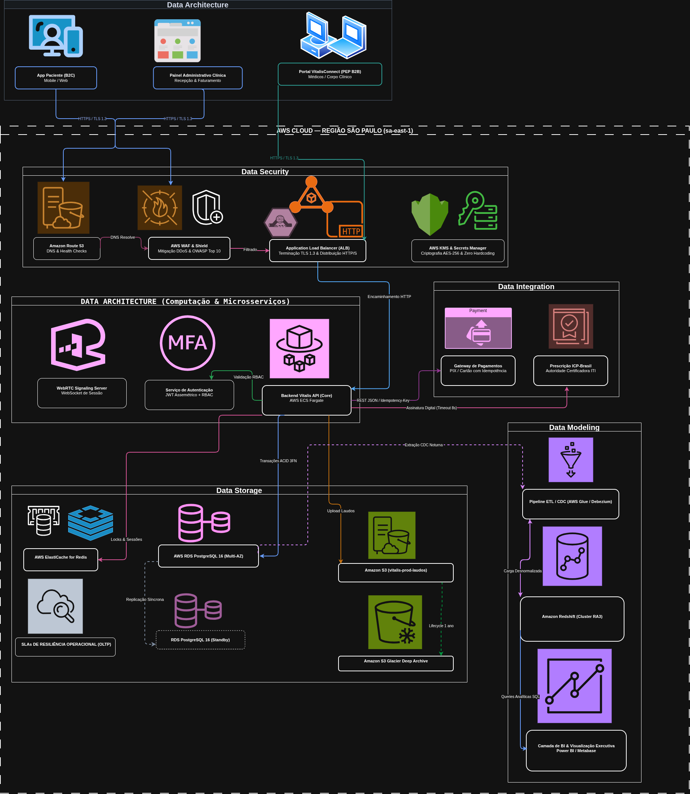
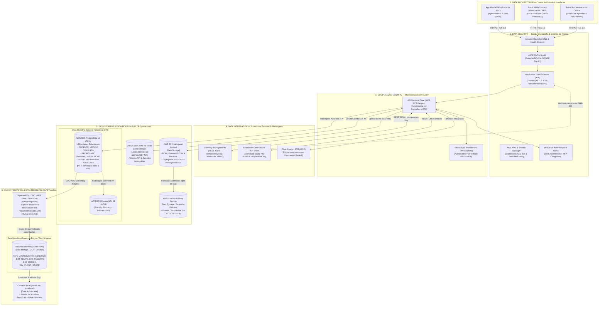

# Arquitetura Consolidada de Dados: Integração de Sistemas

> **Mapeamento Arquitetural Integrado** — Consolidação formal das disciplinas de **Data Architecture, Data Modeling, Data Storage, Data Security e Data Integration** no ecossistema da Vitalis Saúde Digital.

---

## 1. Desenho Consolidado da Arquitetura de Dados

O desenho a seguir apresenta a arquitetura oficial da plataforma **VitalisConnect** em ambiente de produção na **AWS (São Paulo — `sa-east-1`)**, integrando as 5 áreas de dados do ecossistema:

> 📥 **Artefatos do Diagrama de Arquitetura:**
> * 🖼️ **Imagem em Alta Resolução (PNG):** [`diagrams/consolidated-architecture.png`](../../diagrams/consolidated-architecture.png)
> * ✏️ **Arquivo Editável no Draw.io (`.drawio`):** [`diagrams/consolidated-architecture.drawio`](../../diagrams/consolidated-architecture.drawio)

<b>Visualizar Especificação Declarativa em Código (Mermaid)</b>

---

## 2. Rastreabilidade das 5 Disciplinas de Dados no Ecossistema

A tabela a seguir consolida como as decisões tomadas em cada uma das 5 disciplinas convergem para sustentar a operação em produção da Vitalis:

| Disciplina de Dados | Componentes Físicos no Desenho | Papel Técnico na Arquitetura Integrada |
| :--- | :--- | :--- |
| **1. Data Architecture** | `App B2C`, `Portal PEP B2B`, `ALB`, `ECS Core`, `Dashboards BI` | Define a topologia de sistemas, o fluxo de dados de ponta a ponta, a segregação estrita entre OLTP e OLAP e o modelo de contingência *Local-First* no navegador do médico. |
| **2. Data Modeling** | `PostgreSQL 3FN` (10 Entidades) e `Redshift Star Schema` (1 Fato + 4 Dimensões) | Modela a consistência transacional no atendimento clínico (ACID na 3ª Forma Normal) e a otimização colunar multidimensional para BI sem necessidade de JOINs pesados. |
| **3. Data Storage** | `RDS Multi-AZ`, `ElastiCache Redis`, `S3 Standard` e `S3 Glacier Deep Archive` | Garante persistência poliglota especializada: sub-milissegundo para cache, ACID relacional para prontuários, durabilidade de 11 noves para laudos e guarda legal de 20 anos a baixo custo. |
| **4. Data Security** | `TLS 1.3`, `AWS WAF`, `AWS KMS (AES-256)`, `RBAC + MFA`, `LOG_ACESSO` | Estabelece as barreiras perimetrais, criptografia em repouso e trânsito, isolamento por papéis, mascaramento perante a LGPD e trilha de auditoria inviolável. |
| **5. Data Integration** | `REST JSON`, `Webhooks HMAC SHA-256`, `ICP-Brasil`, `AWS Glue CDC`, `SQS DLQ` | Padroniza contratos de integração com provedores terceiros (Gateway e ICP-Brasil), garante resiliência com Circuit Breaker e move dados do OLTP para o OLAP sem paralisar o banco operacional. |

---

## 3. Matriz de Relacionamento e Fluxos de Dados Críticos

### Fluxo Operacional A: Agendamento, Trava de Concorrência e Liquidação
1. O paciente requisita um slot pelo aplicativo (**Data Architecture**).
2. O backend aciona o **AWS ElastiCache for Redis** (**Data Storage**) com comando atômico `SET slot:medico:horario NX EX 600`, prevenindo que dois pacientes agendem o mesmo médico no mesmo minuto.
3. O pagamento é despachado via API REST (**Data Integration**) ao Gateway com chave de idempotência (`Idempotency-Key`).
4. Ao receber a confirmação via Webhook assinado com HMAC SHA-256 (**Data Security**), a transação é gravada nas tabelas `CONSULTA` e `TRANSACAO_PAGAMENTO` (**Data Modeling**) com integridade ACID no **AWS RDS PostgreSQL** (**Data Storage**).

### Fluxo Operacional B: Atendimento Médico, PEP e Emissão de Receita ICP-Brasil
1. O médico acessa a sala de teleconsulta cifrada via WebRTC (**Data Security**).
2. Durante o atendimento, a anamnese e o diagnóstico CID-10 são gravados em `PRONTUARIO` (**Data Modeling**). Uma vez finalizada a consulta, o registro torna-se imutável por regra de banco.
3. O receituário é enviado à autoridade certificadora (**Data Integration**) sob timeout estrito de 8 segundos. O PDF assinado digitalmente com certificado ICP-Brasil é persistido no **AWS S3** (**Data Storage**) com criptografia **SSE-KMS** (**Data Security**).
4. O hash SHA-256 da assinatura é registrado em `PRESCRICAO_DIGITAL` (**Data Modeling**), vinculando o documento físico/digital ao histórico pericial do titular.

### Fluxo Analítico C: Inteligência de Negócio sem Degradação Clínica
1. Durante a janela noturna de menor tráfego, o pipeline **AWS Glue** (**Data Integration**) captura as alterações do PostgreSQL via Change Data Capture (CDC) a partir dos logs de transação (WAL), sem executar `SELECT *` na base operacional.
2. Os dados de pacientes passam por pseudonimização obrigatória com hash irreversível HMAC SHA-256 (**Data Security**), gerando `id_paciente_anonimizado`.
3. Os dados tratados alimentam a tabela `FATO_ATENDIMENTO_ANALITICO` e dimensões no **Amazon Redshift** (**Data Modeling & Data Storage**).
4. A diretoria executiva consulta relatórios gerenciais e taxas de absenteísmo (*no-show*) no **Power BI** (**Data Architecture**) com desempenho analítico colunar, sem consumir 1% de CPU ou memória do banco utilizado pelos médicos.
