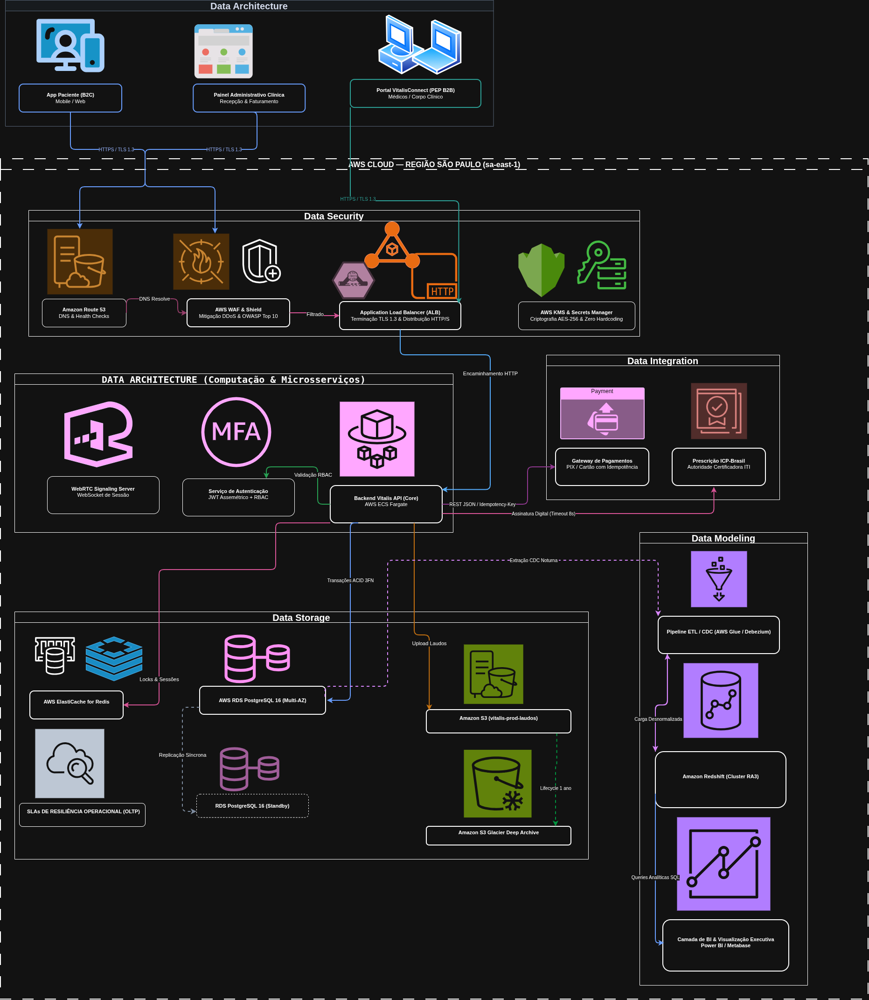

# Arquitetura de Dados Corporativa

## Sumário

- [1. Diretrizes de Arquitetura](#1-diretrizes-de-arquitetura)
- [2. Ecossistema Tecnológico](#2-ecossistema-tecnológico)
- [3. Fluxo de Dados](#3-fluxo-de-dados)
- [4. Resiliência: Modo Offline](#4-resiliência-modo-offline)
- [5. Arquitetura Consolidada de Dados: Integração de Sistemas](#5-arquitetura-consolidada-de-dados-integração-de-sistemas)
  - [5.1. Desenho Consolidado da Arquitetura de Dados](#51-desenho-consolidado-da-arquitetura-de-dados)
  - [5.2. Rastreabilidade das 5 Disciplinas de Dados no Ecossistema](#52-rastreabilidade-das-5-disciplinas-de-dados-no-ecossistema)
  - [5.3. Matriz de Relacionamento e Fluxos de Dados Críticos](#53-matriz-de-relacionamento-e-fluxos-de-dados-críticos)
- [6. Relação com o Negócio e Valor da Solução de Dados](#6-relação-com-o-negócio-e-valor-da-solução-de-dados)
  - [6.1. Data Storage (Armazenamento)](#61-data-storage-armazenamento)
  - [6.2. Data Security (Segurança dos Dados)](#62-data-security-segurança-dos-dados)
  - [6.3. Data Integration (Integração de Sistemas)](#63-data-integration-integração-de-sistemas)
  - [6.4. Data Architecture + Data Modeling](#64-data-architecture--data-modeling)

---

## 1. Diretrizes de Arquitetura

A arquitetura da **Vitalis Saúde Digital** sustenta serviços críticos de telemedicina e Prontuário Eletrônico do Paciente (PEP) operando simultaneamente em modelos B2B e B2C. Três decisões técnicas guiam o ecossistema:

* **Baixa latência clínica:** A consulta e a escrita do prontuário exigem tempo de resposta imediato, sem contenção de recursos computacionais.
* **Conformidade regulatória:** Isolamento de dados clínicos sensíveis (LGPD, Art. 11) e retenção legal obrigatória de 20 anos para prontuários (Lei nº 13.787/2018 e CFM).
* **Isolamento de cargas:** Segregação estrita entre o processamento transacional de atendimento (OLTP) e o processamento analítico de inteligência de negócios (OLAP).

---

## 2. Ecossistema Tecnológico

Cada tecnologia atende a uma demanda computacional específica, evitando centralização excessiva e gargalos de I/O:

| Componente | Tecnologia | Papel Prático na Operação |
| :--- | :--- | :--- |
| **App do Paciente (B2C)** | Web / Mobile | Autoagendamento, sala de espera virtual e acesso a documentos. |
| **Portal Médico (B2B)** | Web SaaS | Anamnese, histórico clínico e prescrições com assinatura digital ICP-Brasil. |
| **Banco Operacional (OLTP)** | PostgreSQL RDS Multi-AZ | Persistência relacional ACID de baixa latência para prontuários, cadastros e agendas. |
| **Armazenamento de Arquivos** | AWS S3 | Guarda de objetos pesados e estáticos (laudos em PDF e imagens médicas DICOM). |
| **Cache em Memória** | AWS ElastiCache for Redis | Gestão centralizada via Backend Vitalis API (Core) de sessões WebRTC, tokens de autenticação e trava temporária de agenda contra duplo agendamento. |
| **Servidores de Mídia** | WebRTC dedicado | Streaming de áudio e vídeo da teleconsulta ponto a ponto, sem sobrecarregar a base de dados. |
| **Integração & Pipeline** | Airflow + CDC (Debezium) | Captura de alterações do banco relacional com sanitização e mascaramento prévio de dados sensíveis. |
| **Data Warehouse (OLAP)** | Amazon Redshift | Banco colunar com modelagem dimensional (*Star Schema*) para consultas analíticas corporativas. |
| **Camada de BI** | Metabase / Power BI | Painéis executivos com indicadores de ocupação, faturamento SaaS e tempos médios de consulta. |

---

## 3. Fluxo de Dados

O dado percorre um ciclo unificado desde a entrada na interface até a camada analítica:

```
[Paciente / Médico] 
       │ (HTTPS / TLS 1.3)
       ▼
[API Gateway / Backend] ──► [AWS ElastiCache for Redis] (Controle de sessão e trava de horário)
       │
       ├──► [PostgreSQL RDS] (Registros clínicos ACID)
       └──► [AWS S3] (Armazenamento de PDFs e exames pesados)
                 │
                 ▼ (Carga incremental diária via CDC / Airflow)
       [Amazon Redshift DW]
                 │
                 ▼
       [Dashboards de BI]
```

1. **Ingestão e Agendamento:** O paciente agenda a consulta; a aplicação valida a disponibilidade no AWS ElastiCache for Redis e persiste o agendamento no PostgreSQL RDS.
2. **Atendimento Clínico:** A teleconsulta ocorre via WebRTC. O médico digita anotações clínicas diretamente no prontuário e assina receitas digitais; laudos e exames anexados são enviados ao AWS S3 via URLs pré-assinadas.
3. **Extração e Tratamento:** Cargas incrementais via Change Data Capture (CDC) extraem alterações da base operacional sem bloqueios de tabela, aplicando anonimização nos dados protegidos pela LGPD.
4. **Carga e Visualização:** O Amazon Redshift consolida os dados na tabela `Fato_Atendimento` associada a dimensões temporais e médicas, alimentando os relatórios da diretoria sem onerar o atendimento médico.

---

## 4. Resiliência: Modo Offline

Para evitar interrupção no atendimento médico em caso de queda de conexão na clínica, o Portal VitalisConnect adota arquitetura *Local-First* com sincronização assíncrona:

* **Persistência Local:** O rascunho da anamnese e itens da prescrição são gravados em tempo real no banco local do navegador (IndexedDB) com criptografia de sessão.
* **Fila em Background:** A aplicação gera identificadores globais (`UUIDv4`) para cada transação e retém as ações em fila local gerenciada por um *Service Worker*.
* **Sincronização Idempotente:** Assim que a conexão HTTPS é restabelecida, o *Service Worker* despacha a fila para a API REST, que utiliza o `UUID` para descartar duplicidades e consolida os registros no PostgreSQL central.

---

## 5. Arquitetura Consolidada de Dados: Integração de Sistemas

> **Mapeamento Arquitetural Integrado** — Consolidação formal das disciplinas de **Data Architecture, Data Modeling, Data Storage, Data Security e Data Integration** no ecossistema da Vitalis Saúde Digital.

---

### 5.1. Desenho Consolidado da Arquitetura de Dados

O desenho a seguir apresenta a arquitetura oficial da plataforma **VitalisConnect** em ambiente de produção na **AWS (São Paulo — `sa-east-1`)**, integrando as 5 áreas de dados do ecossistema:



> **Artefatos do Diagrama de Arquitetura:**
> * **Imagem em Alta Resolução (PNG):** [`diagrams/consolidated-architecture.png`](../../diagrams/consolidated-architecture.png)
> * **Arquivo Editável no Draw.io (`.drawio`):** [`diagrams/consolidated-architecture.drawio`](../../diagrams/consolidated-architecture.drawio)


---

### 5.2. Rastreabilidade das 5 Disciplinas de Dados no Ecossistema

A tabela a seguir consolida como as decisões tomadas em cada uma das 5 disciplinas convergem para sustentar a operação em produção da Vitalis:

| Disciplina de Dados | Componentes Físicos no Desenho | Papel Técnico na Arquitetura Integrada |
| :--- | :--- | :--- |
| **1. Data Architecture** | `App B2C`, `Portal PEP B2B`, `ALB`, `ECS Core`, `Dashboards BI` | Define a topologia de sistemas, o fluxo de dados de ponta a ponta, a segregação estrita entre OLTP e OLAP e o modelo de contingência *Local-First* no navegador do médico. |
| **2. Data Modeling** | `PostgreSQL 3FN` (10 Entidades) e `Redshift Star Schema` (1 Fato + 4 Dimensões) | Modela a consistência transacional no atendimento clínico (ACID na 3ª Forma Normal) e a otimização colunar multidimensional para BI sem necessidade de JOINs pesados. |
| **3. Data Storage** | `RDS Multi-AZ`, `AWS ElastiCache for Redis`, `S3 Standard` e `S3 Glacier Deep Archive` | Garante persistência poliglota especializada: sub-milissegundo para cache (centralizado no Backend Vitalis API (Core) para locks de agenda, tokens de autenticação e sessões WebRTC), ACID relacional para prontuários, durabilidade de 11 noves para laudos e guarda legal de 20 anos a baixo custo. |
| **4. Data Security** | `TLS 1.3`, `AWS WAF`, `AWS KMS (AES-256)`, `RBAC + MFA`, `LOG_ACESSO` | Estabelece as barreiras perimetrais, criptografia em repouso e trânsito, isolamento por papéis, mascaramento perante a LGPD e trilha de auditoria inviolável. |
| **5. Data Integration** | `REST JSON`, `Webhooks HMAC SHA-256`, `ICP-Brasil`, `AWS Glue CDC`, `SQS DLQ` | Padroniza contratos de integração com provedores terceiros (Gateway e ICP-Brasil), garante resiliência com Circuit Breaker e move dados do OLTP para o OLAP sem paralisar o banco operacional. |

---

### 5.3. Matriz de Relacionamento e Fluxos de Dados Críticos

#### 5.3.1. Fluxo Operacional: Agendamento, Trava de Concorrência e Liquidação
1. O paciente requisita um slot pelo aplicativo (**Data Architecture**).
2. O backend aciona o **AWS ElastiCache for Redis** (**Data Storage**) com comando atômico `SET slot:medico:horario NX EX 600`, prevenindo que dois pacientes agendem o mesmo médico simultaneamente (na mesma fração de segundo), em que o parâmetro `NX` bloqueia a concorrência em milissegundos e o `EX 600` define a expiração automática da trava em 10 minutos (600 segundos).
3. O pagamento é despachado via API REST (**Data Integration**) ao Gateway com chave de idempotência (`Idempotency-Key`).
4. Ao receber a confirmação via Webhook assinado com HMAC SHA-256 (**Data Security**), a transação é gravada nas tabelas `CONSULTA` e `TRANSACAO_PAGAMENTO` (**Data Modeling**) com integridade ACID no **AWS RDS PostgreSQL** (**Data Storage**).

#### 5.3.2. Fluxo Operacional: Atendimento Médico, PEP e Emissão de Receita ICP-Brasil
1. O médico acessa a sala de teleconsulta cifrada via WebRTC (**Data Security**).
2. Durante o atendimento, a anamnese e o diagnóstico CID-10 são gravados em `PRONTUARIO` (**Data Modeling**). Uma vez finalizada a consulta, o registro torna-se imutável por regra de banco.
3. O receituário é enviado à autoridade certificadora (**Data Integration**) sob timeout estrito de 8 segundos. O PDF assinado digitalmente com certificado ICP-Brasil é persistido no **AWS S3** (**Data Storage**) com criptografia **SSE-KMS** (**Data Security**).
4. O hash SHA-256 da assinatura é registrado em `PRESCRICAO_DIGITAL` (**Data Modeling**), vinculando o documento físico/digital ao histórico pericial do titular.

#### 5.3.3. Fluxo Analítico: Inteligência de Negócio sem Degradação Clínica
1. Durante a janela noturna de menor tráfego, o pipeline **AWS Glue** (**Data Integration**) captura as alterações do PostgreSQL via Change Data Capture (CDC) a partir dos logs de transação (WAL), sem executar `SELECT *` na base operacional.
2. Os dados de pacientes passam por pseudonimização obrigatória com hash irreversível HMAC SHA-256 (**Data Security**), gerando `id_paciente_anonimizado`.
3. Os dados tratados alimentam a tabela `FATO_ATENDIMENTO_ANALITICO` e dimensões no **Amazon Redshift** (**Data Modeling & Data Storage**).
4. A diretoria executiva consulta relatórios gerenciais e taxas de absenteísmo (*no-show*) no **Power BI** (**Data Architecture**) com desempenho analítico colunar, sem consumir 1% de CPU ou memória do banco utilizado pelos médicos.

---

## 6. Relação com o Negócio e Valor da Solução de Dados

Este documento explica de forma direta como as escolhas técnicas feitas no projeto atendem às necessidades operacionais, financeiras e regulatórias da **Vitalis Saúde Digital**.

---

### 6.1. Data Storage (Armazenamento)

A estratégia de armazenamento foi dividida por tipo de dado e tempo de retenção para equilibrar custo e disponibilidade:

* **Controle de custos no longo prazo (S3 Glacier):** A Lei nº 13.787/2018 exige a guarda de prontuários e exames por 20 anos. Manter terabytes de imagens médicas (DICOM) e PDFs no storage padrão geraria um custo insustentável. Com as regras de ciclo de vida no **AWS S3**, arquivos com mais de 90 dias migram automaticamente para o **S3 Glacier Deep Archive**, reduzindo o custo de armazenamento em mais de 90% (menos de US$ 0,001 por GB/mês).
* **Continuidade do atendimento (RDS Multi-AZ e PITR):** O banco operacional roda no **AWS RDS PostgreSQL** com replicação síncrona em duas zonas de disponibilidade (Multi-AZ). Se o servidor principal falhar, o nó reserva assume em menos de 60 segundos. O backup contínuo dos logs de transação (Point-in-Time Recovery a cada 5 minutos) garante **RPO < 5 minutos** e **RTO < 1 hora**, impedindo perda de dados clínicos.
* **Telas rápidas para o médico (AWS ElastiCache for Redis):** O **AWS ElastiCache for Redis**, acessado pelo Backend Vitalis API (Core), armazena sessões ativas e faz o bloqueio temporário de horários de agenda (`SET NX`). Isso alivia o PostgreSQL de leituras repetitivas e mantém as consultas do Prontuário Eletrônico do Paciente (PEP) respondendo em menos de 100 ms.

---

### 6.2. Data Security (Segurança dos Dados)

A segurança protege a empresa contra penalidades legais e garante a confiança dos médicos e pacientes:

* **Conformidade com a LGPD e mitigação de multas:** Dados de saúde são sensíveis (Art. 11 da LGPD). A plataforma utiliza criptografia **AES-256** em repouso no RDS e S3, e **TLS 1.3** em trânsito. Para relatórios, os dados de pacientes são pseudonimizados com hash HMAC SHA-256 antes de entrarem no Data Warehouse, mitigando o risco de sanções da ANPD (que podem chegar a 2% do faturamento).
* **Segurança jurídica médica (CFM):** Conforme a Resolução CFM nº 2.314/2022, prontuários não podem ser alterados após finalizados. A tabela `PRONTUARIO` é logicamente imutável: qualquer retificação exige a inserção de um adendo auditável com carimbo de tempo, servindo de respaldo pericial para o médico e para a clínica em eventuais litígios.
* **Controle de acesso por função (RBAC):** Profissionais da recepção e do financeiro visualizam apenas dados cadastrais e de pagamento. O acesso ao histórico clínico, diagnósticos (CID-10) e prescrições é restrito exclusivamente ao médico responsável pelo atendimento.
* **Trilha de auditoria (`LOG_ACESSO`):** Qualquer consulta a dados clínicos gera um registro imutável com IP, identificador do usuário e horário exato. O formato *append-only* (sem `UPDATE` ou `DELETE`) cumpre o Marco Civil da Internet e viabiliza auditorias de segurança imediatas.

---

### 6.3. Data Integration (Integração de Sistemas)

As integrações padronizadas melhoram a rotina da clínica e eliminam processos manuais:

* **Cobrança automática e sem duplicidade:** A integração via API REST com o gateway gera cobranças PIX e cartão. O uso de **chaves de idempotência** (`Idempotency-Key`) no cabeçalho HTTP impede cobranças duplicadas em caso de oscilação na internet do paciente. A confirmação é recebida por **Webhooks assinados** com HMAC SHA-256, liberando a consulta sem intervenção manual da recepção.
* **Receitas digitais válidas (ICP-Brasil):** A integração com a autoridade certificadora assina prescrições e atestados com padrão PKI-Brasil e carimbo do tempo. O PDF resultante tem validade legal em qualquer farmácia do país, eliminando blocos de papel, carimbos físicos e custos com motoboy para envio de receitas de medicamentos controlados.
* **Proteção contra falhas externas (Circuit Breaker e DLQ):** Se o gateway de pagamento ou o serviço de assinatura ficarem lentos, a aplicação aplica **timeouts estritos** (5s para pagamento e 8s para assinatura digital). Falhas recorrentes acionam o *Circuit Breaker*, evitando travar a aplicação, e mensagens não entregues seguem para filas de contingência (**Amazon SQS DLQ**) para reprocessamento automático.

---

### 6.4. Data Architecture + Data Modeling

A união da arquitetura em nuvem com a modelagem de dados responde diretamente às 7 necessidades do negócio:

#### 6.4.1. Dados mais organizados
O banco relacional separa claramente os domínios funcionais:
* **Clínico:** `PACIENTE`, `MEDICO`, `CONSULTA`, `PRONTUARIO`, `PRESCRICAO_DIGITAL`.
* **Financeiro:** `PLANO_SAUDE`, `PACIENTE_PLANO`, `TRANSACAO_PAGAMENTO`.
* **Auditoria:** `TICKET_SUPORTE_CRM`, `LOG_ACESSO`.
* **Analítico:** Tabela fato `FATO_ATENDIMENTO_ANALITICO` e dimensões de tempo, médico, paciente e plano. Cada dado tem uma única fonte da verdade, sem tabelas soltas.

#### 6.4.2. Redução de inconsistências
A normalização em **3ª Forma Normal (3FN)** impede anomalias de cadastro. Restrições de banco (`UNIQUE` no CPF, no CRM/UF e no ID da consulta do prontuário) barram duplicidades na raiz. As travas no AWS ElastiCache for Redis evitam que dois pacientes agendem a mesma vaga do médico (*overbooking*).

#### 6.4.3. Melhoria na tomada de decisão (Isolamento OLTP vs. OLAP)
A separação física entre o **PostgreSQL (operacional)** e o **Amazon Redshift (Data Warehouse)** é a decisão mais importante da arquitetura:
* A diretoria roda relatórios analíticos de múltiplos anos no Redshift e no Power BI sem consumir memória ou CPU do PostgreSQL.
* O médico atende na ponta sem lentidão ou travamentos de tela durante a escrita do prontuário.

#### 6.4.4. Aumento da segurança
Os dados clínicos residem em sub-redes privadas da AWS, inacessíveis pela internet pública. Além disso, a separação entre a tabela de cadastro (`PACIENTE`) e a clínica (`PRONTUARIO`) garante que permissões de faturamento nunca exponham diagnósticos médicos.

#### 6.4.5. Integração entre diferentes sistemas
A modelagem inclui identificadores de rastreabilidade externa:
* `codigo_gateway` na transação financeira para conciliação bancária automática com a operadora.
* `assinatura_digital` (hash SHA-256) na prescrição para validação imediata do documento no validador do ITI/CFM.
* `id_consulta_origem` no Data Warehouse para auditar a linhagem de cada métrica até o registro original.

#### 6.4.6. Facilidade na evolução do sistema
A divisão modular de microsserviços e a persistência poliglota permitem expandir a plataforma para novas especialidades (como nutrição ou exames laboratoriais) sem precisar reestruturar o núcleo do banco existente.

#### 6.4.7. Utilização dos dados para gerar valor de negócio (KPIs)
O modelo analítico do Redshift transforma registros brutos em decisões práticas:

| Indicador (KPI) | Origem no Modelo | Decisão de Negócio Viabilizada |
| :--- | :--- | :--- |
| **Taxa de Faltas (*No-Show*)** | `Fato_Atendimento.fl_atendimento_concluido` | Identifica dias e turnos com mais faltas e aciona lembretes automáticos via WhatsApp para diminuir horas ociosas de consultório. |
| **Tempo de Espera e Consulta** | `tempo_espera_min` e `duracao_atendimento_min` | Avalia atrasos e ajusta o tempo padrão dos agendamentos por especialidade. |
| **Rentabilidade por Convênio** | `valor_consulta` e `valor_repasse_medico` | Compara a margem líquida entre atendimentos particulares e planos de saúde para orientar reajustes de contratos. |
| **Sazonalidade Regional** | `DIM_TEMPO` e `DIM_PACIENTE.regiao_brasil` | Ajusta as escalas de médicos plantonistas de telemedicina em períodos de surtos sazonais (ex.: síndromes gripais). |

