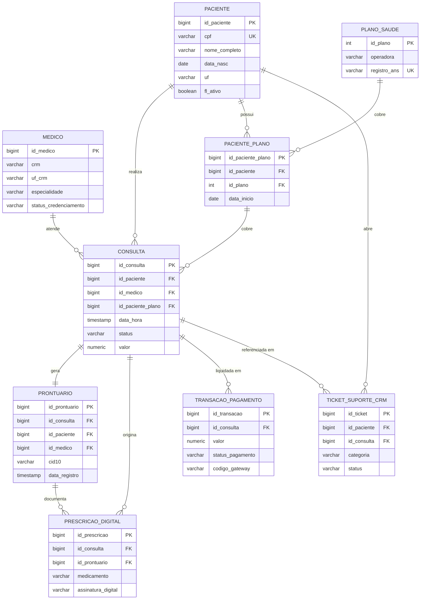
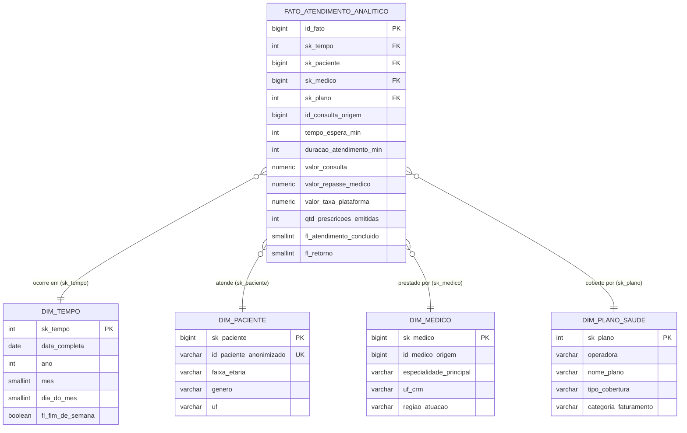

# Modelagem Lógica e Esquema Dimensional de Dados

## 1. Modelo Relacional Operacional (OLTP — PostgreSQL 16)

O banco de dados operacional da **Vitalis Saúde Digital** é estruturado em **3ª Forma Normal (3FN)** sobre o **AWS RDS PostgreSQL 16**, garantindo integridade referencial, conformidade transacional (ACID) e segregação lógica entre dados cadastrais e dados clínicos sensíveis (LGPD).

### 1.1 Entidades do Banco Operacional

| Entidade | Domínio | Função Operacional |
| :--- | :--- | :--- |
| `PACIENTE` | Clínico | Cadastro e identificação do usuário titular de saúde. |
| `MEDICO` | Clínico | Corpo clínico credenciado (CRM, especialidades e credenciamento). |
| `CONSULTA` | Clínico | Agendamentos, sessões de telemedicina e controle de status. |
| `PRONTUARIO` | Clínico | Registro do Prontuário Eletrônico do Paciente (PEP), anamnese e conduta. |
| `PRESCRICAO_DIGITAL` | Clínico | Receituário médico digital emitido com certificação ICP-Brasil. |
| `PLANO_SAUDE` | Financeiro | Catálogo de operadoras e convênios parceiros credenciados. |
| `PACIENTE_PLANO` | Financeiro | Histórico de vigência e associação entre paciente e plano de saúde. |
| `TRANSACAO_PAGAMENTO` | Financeiro | Liquidação financeira da consulta via PIX, cartão ou convênio. |
| `TICKET_SUPORTE_CRM` | Suporte | Gestão de chamados técnicos e operacionais abertos por pacientes. |
| `LOG_ACESSO` | Auditoria | Trilha de auditoria *append-only* de acessos e operações clínicas (LGPD). |

---

### 1.2 Dicionário de Dados Operacional (PostgreSQL)

#### `PACIENTE`
| Atributo | Tipo | Restrições | Descrição |
| :--- | :--- | :--- | :--- |
| `id_paciente` | BIGSERIAL | PK | Identificador único do paciente |
| `nome_completo` | VARCHAR(150) | NOT NULL | Nome civil completo |
| `cpf` | VARCHAR(11) | NOT NULL, UNIQUE | CPF sem máscara (somente dígitos) |
| `data_nasc` | DATE | NOT NULL | Data de nascimento |
| `genero` | VARCHAR(20) | NOT NULL | Gênero declarado pelo paciente |
| `telefone` | VARCHAR(20) | NULL | Telefone para contato |
| `email` | VARCHAR(150) | NULL | E-mail para notificações e login |
| `cidade` | VARCHAR(100) | NOT NULL | Município de residência |
| `uf` | VARCHAR(2) | NOT NULL | Sigla da Unidade Federativa |
| `data_cadastro` | TIMESTAMP | NOT NULL, DEFAULT now() | Data e hora do cadastro |
| `fl_ativo` | BOOLEAN | NOT NULL, DEFAULT TRUE | Status ativo do cadastro (*soft delete*) |

> **Nota LGPD:** Os dados cadastrais residem em `PACIENTE`, enquanto diagnósticos e histórico médico residem exclusivamente em `PRONTUARIO`.

#### `MEDICO`
| Atributo | Tipo | Restrições | Descrição |
| :--- | :--- | :--- | :--- |
| `id_medico` | BIGSERIAL | PK | Identificador único do profissional |
| `nome_completo` | VARCHAR(150) | NOT NULL | Nome civil do médico |
| `crm` | VARCHAR(15) | NOT NULL | Número de inscrição no CRM |
| `uf_crm` | VARCHAR(2) | NOT NULL | UF de emissão do registro CRM |
| `especialidade` | VARCHAR(100) | NOT NULL | Especialidade médica principal |
| `subespecialidade` | VARCHAR(100) | NULL | Subespecialidade (se houver) |
| `regiao_atuacao` | VARCHAR(50) | NOT NULL | Região de atuação credenciada |
| `data_credenciamento`| DATE | NOT NULL | Data de início de atuação na Vitalis |
| `status_credenciamento`| VARCHAR(20) | NOT NULL, CHECK IN ('ATIVO','SUSPENSO','INATIVO') | Situação cadastral do profissional |

> Restrição de unicidade composta: `UNIQUE (crm, uf_crm)`.

#### `CONSULTA`
| Atributo | Tipo | Restrições | Descrição |
| :--- | :--- | :--- | :--- |
| `id_consulta` | BIGSERIAL | PK | Identificador único da consulta |
| `id_paciente` | BIGINT | FK -> PACIENTE, NOT NULL | Paciente atendido |
| `id_medico` | BIGINT | FK -> MEDICO, NOT NULL | Médico responsável |
| `id_paciente_plano` | BIGINT | FK -> PACIENTE_PLANO, NULL | Convênio utilizado (NULL = particular) |
| `data_hora` | TIMESTAMP | NOT NULL | Data/hora agendada do atendimento |
| `data_hora_inicio` | TIMESTAMP | NULL | Início real do atendimento na sala virtual |
| `data_hora_fim` | TIMESTAMP | NULL | Término efetivo do atendimento |
| `status` | VARCHAR(20) | NOT NULL, CHECK IN ('AGENDADA','EM_ANDAMENTO','CONCLUIDA','CANCELADA','NO_SHOW') | Situação do agendamento |
| `valor` | NUMERIC(10,2) | NOT NULL, CHECK (valor >= 0) | Preço de tabela da consulta |
| `tipo_atendimento` | VARCHAR(20) | NOT NULL, CHECK IN ('TELEMEDICINA','PRESENCIAL') | Modalidade do atendimento |
| `data_criacao` | TIMESTAMP | NOT NULL, DEFAULT now() | Momento da marcação |

#### `PRONTUARIO`
| Atributo | Tipo | Restrições | Descrição |
| :--- | :--- | :--- | :--- |
| `id_prontuario` | BIGSERIAL | PK | Identificador único do prontuário |
| `id_consulta` | BIGINT | FK -> CONSULTA, NOT NULL, UNIQUE | Consulta vinculada (relação estrita 1:1) |
| `id_paciente` | BIGINT | FK -> PACIENTE, NOT NULL | Paciente titular (para RBAC e auditoria) |
| `id_medico` | BIGINT | FK -> MEDICO, NOT NULL | Médico responsável pelo registro |
| `queixa_principal` | VARCHAR(300) | NOT NULL | Motivo declarado da consulta |
| `anamnese` | TEXT | NOT NULL | Relato clínico, sinais e sintomas |
| `historico_clinico`| TEXT | NULL | Histórico e antecedentes relevantes |
| `diagnostico` | VARCHAR(300) | NULL | Hipótese diagnóstica ou conclusão |
| `cid10` | VARCHAR(10) | NULL | Código de Classificação Internacional de Doenças |
| `conduta` | VARCHAR(500) | NULL | Conduta médica e orientações |
| `observacoes` | TEXT | NULL | Observações complementares |
| `data_registro` | TIMESTAMP | NOT NULL, DEFAULT now() | Momento da finalização (imutável) |

> **Imutabilidade Clínica:** Registros de `PRONTUARIO` são imutáveis após commit. Retificações clínicas exigem registro aditivo para garantir auditoria pericial conforme Resolução CFM nº 2.314/2022.

#### `PRESCRICAO_DIGITAL`
| Atributo | Tipo | Restrições | Descrição |
| :--- | :--- | :--- | :--- |
| `id_prescricao` | BIGSERIAL | PK | Identificador do item de receita |
| `id_consulta` | BIGINT | FK -> CONSULTA, NOT NULL | Consulta de origem |
| `id_prontuario` | BIGINT | FK -> PRONTUARIO, NOT NULL | Registro clínico ao qual se vincula |
| `medicamento` | VARCHAR(200) | NOT NULL | Fármaco ou produto prescrito |
| `posologia` | VARCHAR(200) | NOT NULL | Dose, frequência e tempo de uso |
| `via_administracao`| VARCHAR(50) | NULL | Via de aplicação (ex.: Oral, Tópica) |
| `data_emissao` | TIMESTAMP | NOT NULL, DEFAULT now() | Data/hora de emissão |
| `validade_dias` | INT | NOT NULL, DEFAULT 30 | Dias de validade legal da receita |
| `assinatura_digital`| VARCHAR(64) | NULL | Hash SHA-256 do certificado ICP-Brasil |
| `status` | VARCHAR(20) | NOT NULL, CHECK IN ('RASCUNHO','ASSINADA','ENTREGUE','CANCELADA') | Situação do receituário |

#### `PLANO_SAUDE`
| Atributo | Tipo | Restrições | Descrição |
| :--- | :--- | :--- | :--- |
| `id_plano` | SERIAL | PK | Identificador do plano |
| `operadora` | VARCHAR(100) | NOT NULL | Razão social ou nome da operadora |
| `nome_plano` | VARCHAR(100) | NOT NULL | Denominação comercial |
| `tipo_cobertura` | VARCHAR(30) | NOT NULL | Ambulatorial, Hospitalar, Completo |
| `registro_ans` | VARCHAR(20) | UNIQUE | Código de registro na ANS |
| `ativo` | BOOLEAN | NOT NULL, DEFAULT TRUE | Status de credenciamento na Vitalis |

#### `PACIENTE_PLANO`
| Atributo | Tipo | Restrições | Descrição |
| :--- | :--- | :--- | :--- |
| `id_paciente_plano` | BIGSERIAL | PK | Identificador do vínculo paciente-convênio |
| `id_paciente` | BIGINT | FK -> PACIENTE, NOT NULL | Paciente titular |
| `id_plano` | INT | FK -> PLANO_SAUDE, NOT NULL | Plano contratado |
| `numero_carteirinha`| VARCHAR(30) | NOT NULL | Matrícula da carteirinha do convênio |
| `data_inicio` | DATE | NOT NULL | Início da vigência |
| `data_fim` | DATE | NULL | Fim da vigência (NULL = ativo) |

#### `TRANSACAO_PAGAMENTO`
| Atributo | Tipo | Restrições | Descrição |
| :--- | :--- | :--- | :--- |
| `id_transacao` | BIGSERIAL | PK | Identificador da transação |
| `id_consulta` | BIGINT | FK -> CONSULTA, NOT NULL | Consulta faturada |
| `valor` | NUMERIC(10,2) | NOT NULL, CHECK (valor >= 0) | Valor efetivamente cobrado |
| `metodo` | VARCHAR(20) | NOT NULL, CHECK IN ('PIX','CARTAO_CREDITO','CARTAO_DEBITO','CONVENIO') | Meio de liquidação |
| `status_pagamento`| VARCHAR(20) | NOT NULL, CHECK IN ('PENDENTE','APROVADO','RECUSADO','ESTORNADO') | Situação da transação |
| `data_transacao` | TIMESTAMP | NOT NULL, DEFAULT now() | Momento da liquidação |
| `codigo_gateway` | VARCHAR(60) | NULL | ID de referência externa devolvido pelo gateway |

> **Segurança de Pagamento:** Não são armazenados números de cartão de crédito no banco; armazena-se unicamente a chave de transação retornada pelo Gateway.

#### `TICKET_SUPORTE_CRM`
| Atributo | Tipo | Restrições | Descrição |
| :--- | :--- | :--- | :--- |
| `id_ticket` | BIGSERIAL | PK | Identificador do chamado |
| `id_paciente` | BIGINT | FK -> PACIENTE, NOT NULL | Paciente solicitante |
| `id_consulta` | BIGINT | FK -> CONSULTA, NULL | Consulta relacionada (se houver) |
| `categoria` | VARCHAR(30) | NOT NULL | Tipo (Acesso, Cobrança, Agendamento) |
| `prioridade` | VARCHAR(10) | NOT NULL, CHECK IN ('BAIXA','MEDIA','ALTA') | Grau de urgência |
| `status` | VARCHAR(20) | NOT NULL, CHECK IN ('ABERTO','EM_ATENDIMENTO','RESOLVIDO','FECHADO') | Situação do ticket |
| `descricao` | TEXT | NOT NULL | Detalhamento do chamado |
| `data_abertura` | TIMESTAMP | NOT NULL, DEFAULT now() | Momento de abertura |
| `data_fechamento`| TIMESTAMP | NULL | Momento de resolução |

#### `LOG_ACESSO`
| Atributo | Tipo | Restrições | Descrição |
| :--- | :--- | :--- | :--- |
| `id_log` | BIGSERIAL | PK | Identificador do evento auditado |
| `id_usuario` | BIGINT | NULL | ID do usuário autenticado |
| `acao` | VARCHAR(30) | NOT NULL | Ação (LOGIN, LOGOUT, LEITURA, EXPORTACAO) |
| `recurso` | VARCHAR(50) | NOT NULL | Entidade acessada (ex.: `PRONTUARIO`) |
| `id_registro` | BIGINT | NULL | ID da chave primária visualizada/alterada |
| `resultado` | VARCHAR(10) | NOT NULL, CHECK IN ('SUCESSO','FALHA','NEGADO') | Desfecho da requisição |
| `ip_origem` | INET | NOT NULL | Endereço IP do solicitante |
| `data_hora` | TIMESTAMP | NOT NULL, DEFAULT now() | Timestamp com precisão de milissegundos |

---

### 1.3 Diagrama Entidade-Relacionamento do Banco Operacional (OLTP)

---

## 2. Modelo Dimensional Analítico (OLAP — Amazon Redshift)

O Data Warehouse adota o **Esquema Estrela (Star Schema)** conforme metodologia de Ralph Kimball, implementado sobre o armazenamento colunar distribuído do **Amazon Redshift (Cluster RA3)**.

### 2.1 Processo de Negócio e Granularidade
* **Processo:** Atendimento de telemedicina e liquidação financeira de consultas.
* **Granularidade do Fato:** Um registro por atendimento/consulta individualizada realizada ou liquidada na plataforma VitalisConnect.

---

### 2.2 Entidades do Esquema Estrela

| Entidade | Tipo | Função no Data Warehouse |
| :--- | :--- | :--- |
| `FATO_ATENDIMENTO_ANALITICO` | Fato | Métricas operacionais, clínicas e financeiras por atendimento. |
| `DIM_TEMPO` | Dimensão | Calendário civil completo para análises de séries temporais e sazonalidade. |
| `DIM_PACIENTE` | Dimensão | Perfil demográfico e epidemiológico pseudonimizado (LGPD). |
| `DIM_MEDICO` | Dimensão | Atributos profissionais, especialidade e região de credenciamento. |
| `DIM_PLANO_SAUDE` | Dimensão | Classificação das operadoras de saúde e fontes pagadoras. |

---

### 2.3 Dicionário de Dados Dimensional (Amazon Redshift)

#### `FATO_ATENDIMENTO_ANALITICO`
| Atributo | Tipo (Redshift) | Restrições | Descrição |
| :--- | :--- | :--- | :--- |
| `id_fato` | BIGINT IDENTITY(1,1) | PK | Chave substituta do fato analítico |
| `sk_tempo` | INT | FK -> DIM_TEMPO, NOT NULL | Chave substituta da data do atendimento |
| `sk_paciente` | BIGINT | FK -> DIM_PACIENTE, NOT NULL | Chave substituta do paciente atendido |
| `sk_medico` | BIGINT | FK -> DIM_MEDICO, NOT NULL | Chave substituta do médico assistente |
| `sk_plano` | INT | FK -> DIM_PLANO_SAUDE, NOT NULL | Chave substituta da fonte pagadora (-1 = particular) |
| `id_consulta_origem` | BIGINT | NOT NULL | Chave natural no PostgreSQL (dimensão degenerada) |
| `tempo_espera_min` | INT | NOT NULL, DEFAULT 0 | Minutos de espera na sala virtual |
| `duracao_atendimento_min` | INT | NOT NULL, DEFAULT 0 | Duração da teleconsulta em minutos |
| `valor_consulta` | NUMERIC(10,2) | NOT NULL, DEFAULT 0.00 | Valor total cobrado pelo atendimento |
| `valor_repasse_medico` | NUMERIC(10,2) | NOT NULL, DEFAULT 0.00 | Valor líquido repassado ao corpo clínico |
| `valor_taxa_plataforma` | NUMERIC(10,2) | NOT NULL, DEFAULT 0.00 | Taxa retida pela plataforma Vitalis |
| `qtd_prescricoes_emitidas` | INT | NOT NULL, DEFAULT 0 | Quantidade de receitas digitais assinadas emitidas |
| `fl_atendimento_concluido` | SMALLINT | NOT NULL, CHECK IN (0,1) | 1 = Atendimento realizado, 0 = Cancelado/No-show |
| `fl_retorno` | SMALLINT | NOT NULL, CHECK IN (0,1) | 1 = Retorno, 0 = Primeira consulta |

#### `DIM_TEMPO`
| Atributo | Tipo (Redshift) | Restrições | Descrição |
| :--- | :--- | :--- | :--- |
| `sk_tempo` | INT | PK | Chave temporal no formato YYYYMMDD |
| `data_completa` | DATE | NOT NULL, UNIQUE | Data do calendário civil |
| `ano` | INT | NOT NULL | Ano civil (4 dígitos) |
| `semestre` | SMALLINT | NOT NULL, CHECK IN (1,2) | Semestre civil (1 ou 2) |
| `trimestre` | SMALLINT | NOT NULL, CHECK (trimestre BETWEEN 1 AND 4) | Trimestre civil (1 a 4) |
| `mes` | SMALLINT | NOT NULL, CHECK (mes BETWEEN 1 AND 12) | Mês do ano (1 a 12) |
| `nome_mes` | VARCHAR(20) | NOT NULL | Nome do mês |
| `semana_do_ano` | SMALLINT | NOT NULL, CHECK (semana_do_ano BETWEEN 1 AND 53) | Número da semana no ano |
| `dia_do_mes` | SMALLINT | NOT NULL, CHECK (dia_do_mes BETWEEN 1 AND 31) | Dia numérico |
| `dia_da_semana` | SMALLINT | NOT NULL, CHECK (dia_da_semana BETWEEN 1 AND 7) | Dia da semana (1: Domingo a 7: Sábado) |
| `fl_fim_de_semana`| BOOLEAN | NOT NULL | Flag de final de semana |
| `fl_feriado` | BOOLEAN | NOT NULL | Flag de feriado nacional |

#### `DIM_PACIENTE`
| Atributo | Tipo (Redshift) | Restrições | Descrição |
| :--- | :--- | :--- | :--- |
| `sk_paciente` | BIGINT IDENTITY(1,1) | PK | Chave substituta do paciente |
| `id_paciente_anonimizado`| VARCHAR(64) | NOT NULL, UNIQUE | Hash irreversível (HMAC SHA-256) do ID original |
| `faixa_etaria` | VARCHAR(20) | NOT NULL | Categoria etária ('0-17', '18-29', '30-44', '45-59', '60+') |
| `genero` | VARCHAR(20) | NOT NULL | Gênero declarado |
| `cidade` | VARCHAR(100) | NOT NULL | Cidade de residência |
| `uf` | VARCHAR(2) | NOT NULL | Unidade Federativa |
| `regiao_brasil` | VARCHAR(20) | NOT NULL | Região geográfica (Nordeste, Sudeste, etc.) |
| `tipo_plano_vigente`| VARCHAR(50) | NOT NULL | Modalidade de cobertura ativa |
| `fl_ativo` | BOOLEAN | NOT NULL, DEFAULT TRUE | Status ativo na base |

> **Pseudonimização LGPD:** O CPF e o nome do titular não são carregados no Data Warehouse. Utiliza-se um hash criptográfico irreversível HMAC SHA-256 gerado durante a extração via AWS Glue.

#### `DIM_MEDICO`
| Atributo | Tipo (Redshift) | Restrições | Descrição |
| :--- | :--- | :--- | :--- |
| `sk_medico` | BIGINT IDENTITY(1,1) | PK | Chave substituta do médico |
| `id_medico_origem` | BIGINT | NOT NULL | ID operacional de referência no PostgreSQL |
| `uf_crm` | VARCHAR(2) | NOT NULL | UF de emissão do registro CRM |
| `especialidade_principal`| VARCHAR(100) | NOT NULL | Especialidade médica primária |
| `subespecialidade` | VARCHAR(100) | NULL | Subespecialidade (se houver) |
| `regiao_atuacao` | VARCHAR(50) | NOT NULL | Região de atendimento credenciada |
| `tempo_plataforma_meses`| INT | NOT NULL, DEFAULT 0 | Meses de credenciamento na Vitalis |
| `status_credenciamento`| VARCHAR(20) | NOT NULL | Situação cadastral ('ATIVO', 'SUSPENSO', 'INATIVO') |

#### `DIM_PLANO_SAUDE`
| Atributo | Tipo (Redshift) | Restrições | Descrição |
| :--- | :--- | :--- | :--- |
| `sk_plano` | INT IDENTITY(1,1) | PK | Chave substituta da fonte pagadora (-1 = particular) |
| `id_plano_origem` | INT | NOT NULL | ID do plano no PostgreSQL |
| `operadora` | VARCHAR(100) | NOT NULL | Razão social ou marca da operadora |
| `nome_plano` | VARCHAR(100) | NOT NULL | Nome comercial do produto |
| `tipo_cobertura` | VARCHAR(30) | NOT NULL | Ambulatorial, Hospitalar, Completo, Particular |
| `categoria_faturamento`| VARCHAR(30) | NOT NULL | Conveniado vs. Particular Direto |
| `fl_ativo` | BOOLEAN | NOT NULL, DEFAULT TRUE | Status comercial |

---

### 2.4 Diagrama Entidade-Relacionamento do Data Warehouse (Star Schema)

---

## 3. Matriz de Integração e Rastreabilidade Operacional $\rightarrow$ Analítica

A tabela abaixo sintetiza a linhagem dos dados entre as tabelas operacionais e as dimensões analíticas:

| Tabela de Origem (PostgreSQL) | Entidade de Destino (Redshift) | Transformação no Pipeline (AWS Glue / CDC) |
| :--- | :--- | :--- |
| `CONSULTA` + `TRANSACAO_PAGAMENTO` | `FATO_ATENDIMENTO_ANALITICO` | Consolidação de métricas de tempo de espera, duração e valores faturados por atendimento. |
| `CONSULTA.data_hora` | `DIM_TEMPO` | Decomposição em atributos de calendário civil (ano, trimestre, mês, dia, feriado). |
| `PACIENTE` | `DIM_PACIENTE` | Pseudonimização irreversível via hash HMAC SHA-256 e extração de faixas etárias. |
| `MEDICO` | `DIM_MEDICO` | Carga de atributos profissionais e cálculo de tempo ativo na plataforma. |
| `PLANO_SAUDE` + `PACIENTE_PLANO` | `DIM_PLANO_SAUDE` | Classificação de modalidades de cobertura e canais de faturamento. |
