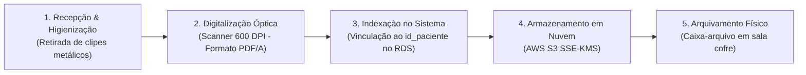

# Armazenamento e Persistência

## Sumário

- [1. Tecnologias utilizadas](#1-tecnologias-utilizadas)
- [2. Organização dos dados](#2-organização-dos-dados)
  - [2.1. Banco de dados — Amazon RDS](#21-banco-de-dados--amazon-rds)
  - [2.2. Arquivos — Amazon S3](#22-arquivos--amazon-s3)
  - [2.3. Cache e sessões — AWS ElastiCache for Redis](#23-cache-e-sessões--aws-elasticache-for-redis)
  - [2.4. Data Warehouse — Amazon Redshift](#24-data-warehouse--amazon-redshift)
- [3. Persistência dos dados](#3-persistência-dos-dados)
- [4. Inserção, atualização e exclusão](#4-inserção-atualização-e-exclusão)
- [5. Integridade e prevenção de duplicidade](#5-integridade-e-prevenção-de-duplicidade)
- [6. Backup e recuperação](#6-backup-e-recuperação)
  - [6.1. Backup da infraestrutura física](#61-backup-da-infraestrutura-física)
  - [6.2. Recuperação dos dados](#62-recuperação-dos-dados)
- [7. Gestão de Prontuários Físicos e Documentos Legados](#7-gestão-de-prontuários-físicos-e-documentos-legados)
  - [7.1. Escopo e Contexto Operacional](#71-escopo-e-contexto-operacional)
  - [7.2. Estrutura e Identificação da Pasta Física](#72-estrutura-e-identificação-da-pasta-física)
  - [7.3. Fluxo de Digitalização e Integração com a Plataforma](#73-fluxo-de-digitalização-e-integração-com-a-plataforma)
  - [7.4. Segurança Física, Custódia e Acesso](#74-segurança-física-custódia-e-acesso)
  - [7.5. Matriz de Riscos Físicos e Mitigações](#75-matriz-de-riscos-físicos-e-mitigações)

---

A Vitalis Saúde Digital utiliza serviços da AWS para armazenar e gerenciar os dados da plataforma. Cada serviço possui uma finalidade específica, separando os dados operacionais, arquivos, informações temporárias e dados utilizados em relatórios.

## 1. Tecnologias utilizadas

| Tecnologia                | Serviço AWS                          | Dados armazenados                                                                             |
| ------------------------- | ------------------------------------ | --------------------------------------------------------------------------------------------- |
| PostgreSQL                | Amazon RDS                           | Cadastros, consultas, prontuários, prescrições, pagamentos e registros de auditoria.          |
| Armazenamento de arquivos | Amazon S3                            | Exames, laudos, documentos, imagens e gravações autorizadas de teleconsultas.                 |
| Cache em memória          | AWS ElastiCache for Redis            | Sessões, cache e reservas temporárias de horários.                                            |
| Data Warehouse            | Amazon Redshift                      | Dados organizados para relatórios e análises da plataforma.                                   |
| Replicação de dados       | AWS Database Migration Service (DMS) | Envio das alterações do banco operacional para o ambiente analítico.                          |
| ETL                       | AWS Glue                             | Preparação e transformação dos dados armazenados no S3 para utilização no ambiente analítico. |

O Amazon RDS é o banco de dados principal da aplicação. O Amazon S3 é responsável pelos arquivos, enquanto o AWS ElastiCache for Redis atende às necessidades temporárias da plataforma (acessado de forma centralizada pelo Backend Vitalis API (Core)).

O Amazon Redshift mantém uma estrutura separada para consultas analíticas, evitando que relatórios sobrecarreguem o banco utilizado nas operações diárias.

## 2. Organização dos dados

### 2.1. Banco de dados — Amazon RDS

O PostgreSQL hospedado no Amazon RDS armazena as informações necessárias ao funcionamento da plataforma.

Os principais dados são:

- Dados cadastrais de pacientes e médicos.
- Agendamentos e informações das consultas.
- Prontuários e prescrições.
- Planos de saúde e pagamentos.
- Registros de acesso e alterações realizadas na plataforma.

O banco utiliza relacionamentos entre tabelas e restrições para manter a integridade das informações.

### 2.2. Arquivos — Amazon S3

O Amazon S3 armazena os arquivos enviados à plataforma, como exames, laudos, documentos e imagens.

Os arquivos são organizados por tipo e data. O banco de dados mantém as referências necessárias para localizar cada arquivo.

O acesso aos documentos é controlado pelo backend, evitando que arquivos clínicos fiquem disponíveis publicamente.

### 2.3. Cache e sessões — AWS ElastiCache for Redis

O AWS ElastiCache for Redis é utilizado (via Backend Vitalis API (Core)) para armazenar informações temporárias, como:

- Sessões de usuários (incluindo sessões WebRTC e tokens de autenticação).
- Dados utilizados frequentemente pela aplicação.
- Reservas temporárias de horários.

Essas informações possuem prazo de validade e podem ser recriadas quando necessário. O AWS ElastiCache for Redis não é utilizado como banco principal da plataforma.

### 2.4. Data Warehouse — Amazon Redshift

O Amazon Redshift armazena os dados utilizados em relatórios e análises.

As informações são organizadas em tabelas de fatos e dimensões, permitindo analisar atendimentos, consultas e indicadores da clínica.

Antes de serem disponibilizados para análise, os dados pessoais devem passar por medidas de proteção, como pseudonimização, sempre que aplicável.

Os arquivos originais, como exames e laudos, permanecem no Amazon S3. O Data Warehouse recebe apenas os dados e metadados necessários às análises.

## 3. Persistência dos dados

Os dados são classificados conforme sua finalidade e necessidade de armazenamento.

| Categoria   | Exemplos                                          | Armazenamento   |
| ----------- | ------------------------------------------------- | --------------- |
| Cadastrais  | Pacientes, médicos e planos de saúde              | Amazon RDS      |
| Clínicos    | Prontuários, diagnósticos e prescrições           | Amazon RDS      |
| Financeiros | Pagamentos e transações                           | Amazon RDS      |
| Auditoria   | Acessos e alterações realizadas                   | Amazon RDS      |
| Arquivos    | Exames, laudos e documentos                       | Amazon S3       |
| Temporários | Sessões, cache e reservas de horários             | AWS ElastiCache for Redis |
| Analíticos  | Indicadores e históricos utilizados em relatórios | Amazon Redshift           |

Os dados clínicos e cadastrais permanecem armazenados conforme as obrigações legais e as políticas de retenção da plataforma.

As informações temporárias armazenadas no AWS ElastiCache for Redis possuem prazo de validade e são removidas automaticamente após esse período.

## 4. Inserção, atualização e exclusão

**Inserção:** os dados enviados pelo aplicativo passam pela API do backend, que verifica as informações antes de encaminhá-las ao banco de dados. Os arquivos são armazenados no S3, e sua referência é registrada no PostgreSQL.

**Atualização:** alterações cadastrais são registradas no banco. Modificações em informações clínicas devem preservar o histórico, identificando o responsável e o momento da alteração.

**Exclusão:** os dados são excluídos conforme as regras da plataforma e as obrigações legais de armazenamento. Quando necessário, o registro pode ser desativado sem apagar imediatamente seu histórico.

A exclusão de arquivos e registros deve respeitar as políticas de retenção aplicáveis aos dados de saúde.

## 5. Integridade e prevenção de duplicidade

A plataforma utiliza mecanismos no banco de dados e no backend para evitar informações inconsistentes e registros duplicados.

Os principais mecanismos são:

| Mecanismo              | Finalidade                                                                         |
| ---------------------- | ---------------------------------------------------------------------------------- |
| Chave primária (PK)    | Identificar cada registro de forma única.                                          |
| Chave estrangeira (FK) | Garantir relacionamentos entre tabelas existentes.                                 |
| Restrição UNIQUE       | Impedir duplicidade em campos que exigem valores únicos.                           |
| NOT NULL e CHECK       | Impedir valores obrigatórios ausentes e informações fora das regras estabelecidas. |
| Transações             | Garantir que operações relacionadas sejam concluídas ou revertidas.                |
| Validação no backend   | Verificar os dados antes de armazená-los.                                          |

Exemplos de aplicação:

- CPF único para cada cadastro de paciente.
- CRM e UF únicos para cada médico.
- Identificação única do prontuário associado à consulta.
- Código único para identificar uma transação de pagamento.

Esses mecanismos reduzem erros de cadastro, duplicidade de registros e inconsistências nas informações clínicas e financeiras.

## 6. Backup e recuperação

A Vitalis utiliza mecanismos de backup para reduzir o risco de perda de informações e permitir a recuperação dos dados em caso de falhas.

| Recurso              | Estratégia de backup                                                                                      |
| -------------------- | --------------------------------------------------------------------------------------------------------- |
| Amazon RDS           | Backups automáticos, snapshots e recuperação para um momento específico (Point-in-Time Recovery).         |
| Amazon S3            | Versionamento dos arquivos e cópias de segurança conforme a política de retenção.                         |
| Amazon Redshift      | Snapshots para recuperação do ambiente analítico.                                                         |
| AWS ElastiCache for Redis | Os dados temporários podem ser recriados a partir das fontes originais.                             |
| Equipamentos físicos | Cópias das configurações de rede e dos arquivos operacionais importantes em armazenamento protegido no S3. |

### 6.1. Backup da infraestrutura física

Além dos serviços em nuvem, a clínica possui equipamentos físicos necessários ao funcionamento da operação, como computadores, roteadores, switches e outros dispositivos de rede.

Para reduzir os impactos de falhas nesses equipamentos, serão adotadas as seguintes medidas:

- **Computadores:** arquivos importantes para a operação devem possuir cópias de segurança no S3, evitando que permaneçam armazenados exclusivamente nas máquinas locais.
- **Equipamentos de rede:** as configurações de roteadores, switches e firewalls devem ser exportadas após alterações e armazenadas em um bucket protegido no S3.
- **Servidores locais:** caso existam, seus dados e configurações devem possuir uma rotina de cópias de segurança para o S3.
- **Recuperação dos equipamentos:** manter um inventário dos equipamentos e procedimentos para reinstalação e substituição em caso de defeitos.

Os backups protegem os dados e as configurações dos equipamentos. A recuperação do próprio hardware depende de manutenção ou substituição do equipamento.

### 6.2. Recuperação dos dados

Em caso de perda ou falha:

1. O banco PostgreSQL pode ser recuperado utilizando os backups e mecanismos de restauração do RDS.
2. Os arquivos do S3 podem ser recuperados utilizando o versionamento e as cópias de segurança.
3. O ambiente analítico pode ser restaurado a partir dos snapshots do Redshift.
4. As informações temporárias do AWS ElastiCache for Redis podem ser recriadas conforme a necessidade da aplicação.
5. Os equipamentos físicos podem ser reconfigurados utilizando as cópias de suas configurações e os procedimentos de recuperação.

Os procedimentos de restauração devem ser testados periodicamente para verificar se os dados podem ser recuperados corretamente.

---

## 7. Gestão de Prontuários Físicos e Documentos Legados

### 7.1. Escopo e Contexto Operacional

Embora a **Vitalis Saúde Digital** opere com foco primário em prontuários eletrônicos em nuvem (PEP), a plataforma mantém rotinas padronizadas para a custódia, digitalização e descarte seguro de documentos em suporte físico (papel) em dois cenários:

1. **Migração de Clínicas Credenciadas:** Recepção de acervos históricos em papel de consultórios e clínicas parceiras que aderem à plataforma.
2. **Termos Manuscritos e Laudos Externos:** Termos de consentimento livre e esclarecido (TCLE) assinados manualmente e exames diagnósticos externos apresentados fisicamente pelo paciente.

---

### 7.2. Estrutura e Identificação da Pasta Física

Cada prontuário físico é acondicionado em pasta suspensa individual plastificada, padronizada com as seguintes divisões internas:

| Seção da Pasta | Conteúdo Documental | Finalidade |
| :--- | :--- | :--- |
| **Capa Padrão** | Etiqueta com `id_paciente`, Nome Completo, CPF e Data de Nascimento | Identificação visual rápida e vinculação unívoca com o banco de dados. |
| **Identificação & Contatos** | Ficha cadastral física, telefones e contatos de emergência | Referência administrativa primária. |
| **Termo de Consentimento** | TCLE original assinado a punho pelo paciente ou responsável legal | Validade jurídica do consentimento de tratamento de dados (LGPD Art. 11). |
| **Anamnese e Evoluções** | Fichas clínicas pautadas com registros históricos, carimbo e assinatura do médico | Histórico pericial anterior à digitalização. |
| **Exames e Laudos Anexos** | Resultados laboratoriais e relatórios médicos impressos | Fixados com grampo plástico (prevenindo oxidação metálica). |

---

### 7.3. Fluxo de Digitalização e Integração com a Plataforma

Todo documento físico recebido é obrigatoriamente digitalizado e indexado à plataforma em até 48 horas úteis:

1. **Digitalização de Alta Resolução:** Digitalização em resolução mínima de 300 a 600 DPI, formato **PDF/A** (padrão arquivístico internacional de preservação de longo prazo).
2. **Indexação no Banco Operacional:** O arquivo digitalizado é vinculado ao `id_paciente` na tabela `PRONTUARIO` ou como anexo no **AWS RDS PostgreSQL**.
3. **Upload Seguro:** Envio direto para o bucket criptografado do **AWS S3** (`vitalis-prod-laudos`) com chave gerenciada no **AWS KMS**.
4. **Localização Topográfica:** O sistema registra a posição física do documento original em papel (Exemplo: *Arquivo Central, Corredor 1, Armário B, Caixa 12*).

---

### 7.4. Segurança Física, Custódia e Acesso

* **Ambiente de Guarda:** Sala de arquivo dedicada na sede administrativa da Vitalis, trancada, com climatização controlada (umidade entre 45% e 55%) e sistema anti-incêndio por gás inerte (sem água, para preservar o papel).
* **Controle de Acesso Físico:** Entrada permitida exclusivamente à equipe de arquivo documental autorizada.
* **Cadeia de Custódia (Livro de Cautela):** Qualquer retirada temporária de pasta física exige registro manual e digital (responsável, motivo clínico/jurídico, data de saída e devolução obrigatória em até 48 horas).
* **Tempo de Guarda Obrigatório:** O suporte físico é mantido pelo prazo mínimo de **20 (vinte) anos**, em estrita conformidade com o Art. 6º da Lei nº 13.787/2018 e resoluções do Conselho Federal de Medicina (CFM).

---

### 7.5. Matriz de Riscos Físicos e Mitigações

| Risco Físico | Impacto | Estratégia de Mitigação |
| :--- | :--- | :--- |
| **Incêndio ou Alagamento** | Perda irreversível de registros históricos | Sala elevada do solo, extintores à base de gás inerte (FM-200) e digitalização prévia no AWS S3. |
| **Degradação Natural do Papel** | Ilegibilidade de anotações médicas | Uso de grampos plásticos (sem oxidação), ambiente livre de incidência solar direta e cópias digitais em PDF/A. |
| **Extravio ou Acesso Não Autorizado** | Violação de sigilo médico e infração da LGPD | Sala com acesso biométrico restrito, etiquetagem por código e protocolo rígido de cautela com devolução controlada. |
