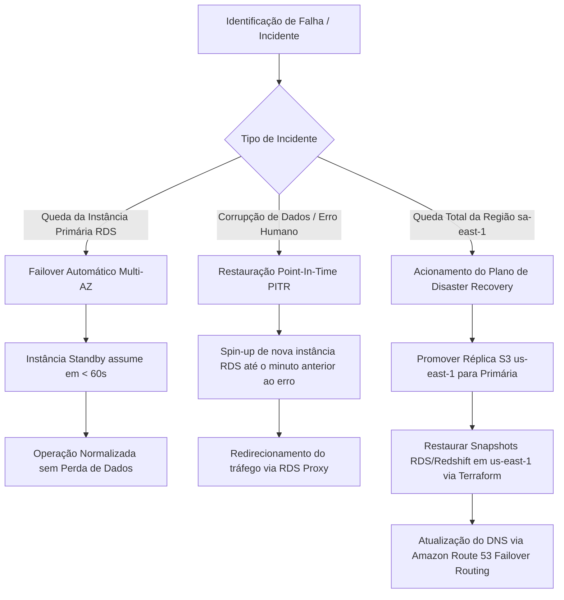

# Armazenamento e Persistência

_Responsável: Hudnei Sued Passos Santana_

A Vitalis Saúde Digital adota uma arquitetura de persistência poliglota: cada categoria de dado é armazenada na tecnologia mais adequada ao seu padrão de acesso, volume e exigência regulatória. A combinação **PostgreSQL + Redis + Amazon S3** atende ao núcleo operacional, aos dados temporários de baixa latência e aos arquivos não estruturados, enquanto o **Amazon Redshift** complementa a camada analítica.

## A. Armazenamento

### A.1 Tecnologias, justificativas e dados armazenados

| Tecnologia          | Serviço                                  | Dados armazenados                                                                               | Por que foi escolhida                                                                                                                                             |
| :------------------ | :--------------------------------------- | :---------------------------------------------------------------------------------------------- | :---------------------------------------------------------------------------------------------------------------------------------------------------------------- |
| **PostgreSQL**      | Amazon RDS Multi-AZ (região `sa-east-1`) | Cadastros, consultas, prontuários, prescrições, planos, pagamentos, tickets e logs de auditoria | Banco relacional com ACID, integridade referencial e restrições `UNIQUE`/`FK`/`CHECK`; suporta PITR, réplica de leitura e é maduro para dados sensíveis de saúde. |
| **Redis**           | Amazon ElastiCache for Redis             | Sessões de teleconsulta, tokens, cache, locks e horários temporariamente reservados             | Armazenamento em memória com latência sub-milissegundo e TTL nativo; evita sobrecarregar o PostgreSQL com dados que expiram.                                      |
| **Amazon S3**       | S3 (Cloudflare R2 como alternativa/DR)   | Exames, laudos, PDFs, imagens DICOM e gravações de teleconsultas                                | Object storage com alta durabilidade, escalabilidade praticamente ilimitada, criptografia AES-256, políticas de ciclo de vida e URLs pré-assinadas.               |
| **Amazon Redshift** | Redshift                                 | `FATO_ATENDIMENTO_ANALITICO` e dimensões do Data Warehouse                                      | Armazenamento colunar em esquema estrela que isola relatórios pesados do banco operacional.                                                                       |

### A.2 Como os dados são organizados

**PostgreSQL (OLTP).** Os dados são organizados em modelo relacional normalizado (3FN), separados por domínio: `core` (paciente, médico, consulta, prontuário, prescrição), `financeiro` (plano, paciente–plano, transação de pagamento), `suporte` (ticket) e `auditoria` (`LOG_ACESSO`). As chaves primárias são `BIGSERIAL`, as relações usam chaves estrangeiras e há índices em CPF, CRM, `id_paciente` e `data_hora`. As tabelas `CONSULTA` e `LOG_ACESSO` são particionadas por mês/ano, e `LOG_ACESSO` é _append-only_ (sem `UPDATE`/`DELETE`).

**Redis.** As chaves seguem namespaces por finalidade: `sessao:{id_consulta}`, `token:{id_usuario}`, `slot:{id_medico}:{data_hora}` e `cache:agenda:{id_medico}`. Cada tipo possui TTL próprio (sessão de 30 a 60 minutos, token de 15 minutos, reserva de horário de 5 a 10 minutos), e cache, sessão e locks podem usar bases lógicas ou instâncias separadas para evitar que uma limpeza de cache derrube sessões ativas.

**Amazon S3.** Os arquivos são separados por ambiente e finalidade (`vitalis-prod-exames`, `vitalis-prod-laudos`, `vitalis-prod-gravacoes` e `vitalis-lake-raw`), com prefixos por data e vínculo clínico: `exames/{ano}/{mes}/{id_paciente}/{id_consulta}/arquivo.pdf`. Usa-se criptografia SSE-KMS, versionamento e políticas de ciclo de vida por prefixo.

**Amazon Redshift.** Os dados analíticos seguem o esquema estrela já modelado: a tabela fato `FATO_ATENDIMENTO_ANALITICO` conectada às dimensões `DIM_TEMPO`, `DIM_PACIENTE`, `DIM_MEDICO` e `DIM_PLANO_SAUDE`, com chaves de distribuição e ordenação voltadas às consultas por período, médico e clínica.

### A.3 Volume esperado

As estimativas abaixo são premissas de planejamento a serem validadas com métricas reais após o lançamento:

- 50 clínicas clientes, 200 médicos ativos e 50.000 pacientes ativos no primeiro ano;
- 20.000 consultas/mês, com crescimento de aproximadamente 10% ao mês no primeiro ano e duplicação da base em 18 a 24 meses;
- prontuário médio de 10 KB, prescrição de 1 KB, cadastro de 2 KB, log de 0,5 KB por evento e arquivo de 5 MB;
- 30% das consultas geram algum anexo (exame, laudo ou imagem).

| Item                 | Cálculo                                          | Volume estimado                                    |
| :------------------- | :----------------------------------------------- | :------------------------------------------------- |
| Dados clínicos       | 20.000 consultas × 10 KB                         | ~200 MB/mês (~2,4 GB/ano)                          |
| Prescrições          | 30.000 prescrições × 1 KB                        | ~30 MB/mês                                         |
| Cadastros            | 50.000 pacientes × 2 KB + médicos/planos         | ~150 MB no ano 1                                   |
| Logs de auditoria    | 20.000 consultas × 100 eventos × 0,5 KB          | ~1 GB/mês (~12 GB/ano)                             |
| **Total PostgreSQL** | Soma dos itens acima + índices                   | **~1,3 GB/mês (~16 GB/ano; ~80–100 GB em 5 anos)** |
| Arquivos no S3       | 6.000 arquivos × 5 MB                            | **~30 GB/mês (~360 GB/ano; ~1,8 TB em 5 anos)**    |
| Redis                | 2.000 sessões concorrentes × 5 KB + cache/tokens | **~1 a 2 GB de memória com folga**                 |

O volume estruturado é modesto para o PostgreSQL, que suporta com tranquilidade centenas de gigabytes. O crescimento relevante está no S3, motivando o uso de políticas de ciclo de vida.

### A.4 Plano de crescimento da infraestrutura

| Fase                    | Período          | Ações                                                                                                                                                                                                    |
| :---------------------- | :--------------- | :------------------------------------------------------------------------------------------------------------------------------------------------------------------------------------------------------- |
| **Fase 1 — Lançamento** | 0 a 12 meses     | RDS `db.r6g.xlarge` Multi-AZ com uma réplica de leitura; ElastiCache com dois nós; bucket S3 em Standard; Auto Scaling e Application Load Balancer; monitoramento e alarmes.                             |
| **Fase 2 — Expansão**   | 12 a 24 meses    | Escala vertical do RDS, réplicas de leitura adicionais, RDS Proxy/PgBouncer para pooling; particionamento mensal/anual de `CONSULTA` e `LOG_ACESSO`; Redis em modo cluster; S3 Intelligent-Tiering.      |
| **Fase 3 — Maturidade** | 24 meses ou mais | Particionamento por clínica/tenant, arquivamento de logs e arquivos antigos no S3 Glacier, Redshift RA3 com concurrency scaling, ambiente de DR em outra zona/região e testes periódicos de restauração. |

O plano mantém o objetivo de **RPO inferior a 5 minutos** e **RTO inferior a 1 hora**, com backups PITR no RDS e versionamento no S3. A separação entre OLTP (PostgreSQL) e OLAP (Redshift) evita que o crescimento analítico degrade o atendimento clínico.

## B. Persistência

### B.1 Dados persistentes e dados temporários

| Categoria                             | Exemplos                                                           | Tecnologia                              | Retenção                                                    |
| :------------------------------------ | :----------------------------------------------------------------- | :-------------------------------------- | :---------------------------------------------------------- |
| **Cadastrais (persistentes)**         | Paciente, médico, plano de saúde e vínculo paciente–plano          | PostgreSQL                              | Enquanto o vínculo estiver ativo, com histórico de vigência |
| **Clínicos (persistentes)**           | Prontuário, anamnese, diagnóstico, prescrição digital              | PostgreSQL                              | Mínimo de 20 anos (Lei nº 13.787/2018)                      |
| **Financeiros (persistentes)**        | Transações de pagamento e conciliação                              | PostgreSQL                              | Conforme obrigação fiscal e contábil                        |
| **Auditoria (persistentes)**          | `LOG_ACESSO` (login, leitura, alteração, exportação)               | PostgreSQL particionado + arquivo no S3 | Mínimo de 6 meses (Marco Civil da Internet)                 |
| **Arquivos (persistentes)**           | Exames, laudos, imagens DICOM e gravações                          | Amazon S3                               | Vinculados ao prazo do prontuário, com lifecycle            |
| **Sessão e cache (temporários)**      | Sessão de teleconsulta, tokens, cache, locks e horários reservados | Redis                                   | TTL curto (minutos), sem persistência definitiva            |
| **Mídia em tempo real (temporários)** | Áudio e vídeo WebRTC da teleconsulta                               | Memória/WebRTC                          | Efêmera; gravação só existe se configurada e enviada ao S3  |

Os dados **persistentes** são os que precisam sobreviver ao atendimento e possuir valor legal ou clínico: prontuários, cadastros, prescrições, pagamentos e logs. Já os dados **temporários** existem apenas durante a operação — a sessão da teleconsulta, os tokens de autenticação, o cache de consultas frequentes e os horários bloqueados temporariamente. No Redis, esses dados recebem TTL e são descartados automaticamente, enquanto no PostgreSQL e no S3 a gravação é definitiva e auditável.

### B.2 Inserção, atualização e exclusão

**Inserção.** Todo dado entra pela API do backend, com validação de formato e regras de negócio antes da gravação. Prontuários só podem ser inseridos após o início do atendimento, e cada operação é executada em transação ACID. Arquivos são enviados ao S3 com hash SHA-256 registrado nos metadados.

**Atualização.** Dados cadastrais podem ser atualizados com registro de auditoria. O prontuário é **imutável após o registro**: correções são feitas por novo registro de retificação, preservando o histórico. Status de consulta e de pagamento evoluem por máquina de estados controlada. `LOG_ACESSO` não permite `UPDATE`.

**Exclusão.** Cadastros usam _soft delete_ (`fl_ativo = false`), preservando o histórico. A exclusão física só ocorre quando não há obrigação legal de guarda. Como a LGPD (Art. 18) prevê eliminação, mas a Lei nº 13.787/2018 exige guarda de prontuários por 20 anos, aplica-se **anonimização/pseudonimização** em vez de exclusão para dados clínicos. No Redis, a exclusão é automática por TTL; no S3, por políticas de ciclo de vida e expiração; no Redshift, por rotinas de retenção.

### B.3 Integridade dos dados

A integridade é garantida em quatro níveis: **de entidade** (chave primária em todas as tabelas), **referencial** (chaves estrangeiras entre consulta, prontuário, prescrição e pagamento), **de domínio** (`NOT NULL`, `CHECK` e tipos definidos, como status e valores não negativos) e **de unicidade** (`UNIQUE` em CPF, CRM + UF, `id_consulta` do prontuário e código do gateway). Transações ACID garantem que uma operação seja concluída por inteiro ou revertida. A imutabilidade do prontuário e o caráter _append-only_ dos logs preservam a rastreabilidade, e a validação na aplicação (CPF, CRM, CID-10) impede dados inconsistentes antes da gravação.

### B.4 Prevenção de perda de informações

A prevenção de perda combina redundância, backup e recuperação: o PostgreSQL roda em RDS **Multi-AZ**, com backups automáticos, snapshots e **Point-in-Time Recovery**, mantendo **RPO inferior a 5 minutos** e **RTO inferior a 1 hora**. O S3 usa versionamento, replicação e alta durabilidade, com _Object Lock_ para documentos de guarda obrigatória. O Redis não é fonte de verdade: se perder dados, sessões e caches são recriados a partir do PostgreSQL. O Redshift mantém snapshots próprios. Complementam o plano o monitoramento com alarmes, testes periódicos de restauração e um ambiente de recuperação de desastres.

### B.5 Prevenção de duplicidade de registros

A duplicidade é tratada em camadas complementares:

| Camada             | Mecanismo                                                                                       | Efeito                                                                    |
| :----------------- | :---------------------------------------------------------------------------------------------- | :------------------------------------------------------------------------ |
| **Banco de dados** | `PACIENTE.cpf UNIQUE`                                                                           | Impede dois cadastros com o mesmo CPF                                     |
| **Banco de dados** | `MEDICO (crm, uf_crm) UNIQUE`                                                                   | Impede credenciamento duplicado do mesmo profissional                     |
| **Banco de dados** | `PRONTUARIO.id_consulta UNIQUE`                                                                 | Garante exatamente um prontuário por consulta (1:1)                       |
| **Banco de dados** | `PACIENTE_PLANO (id_paciente, id_plano, data_inicio) UNIQUE`                                    | Evita vínculo de convênio repetido na mesma vigência                      |
| **Banco de dados** | `CONSULTA (id_medico, data_hora) UNIQUE` ou _exclusion constraint_                              | Impede dois agendamentos no mesmo horário                                 |
| **Banco de dados** | `TRANSACAO_PAGAMENTO.codigo_gateway UNIQUE`                                                     | Garante idempotência da cobrança no gateway                               |
| **Data Warehouse** | `DIM_PACIENTE.id_paciente_anonimizado UNIQUE` e `FATO_ATENDIMENTO_ANALITICO.id_consulta_origem` | Evita duplicar paciente ou atendimento na carga analítica                 |
| **Transações**     | ACID e chaves de idempotência                                                                   | Uma gravação é concluída por inteiro ou desfeita, sem registros parciais  |
| **Redis**          | `SET NX` com TTL para reserva de horário                                                        | Cria um lock temporário e impede que dois pacientes reservem o mesmo slot |
| **S3**             | Hash SHA-256 do arquivo no nome/metadados e versionamento                                       | Evita upload duplicado do mesmo exame ou laudo                            |
| **Aplicação/ETL**  | Normalização de CPF (somente dígitos), _trim_, padronização de caixa e _upsert_                 | Reduz duplicidade por variação de preenchimento antes de chegar ao banco  |

Além das restrições, o próprio modelo já separa responsabilidades — dados cadastrais em `PACIENTE` e dados clínicos em `PRONTUARIO` — o que evita redundância e mantém uma única fonte de verdade para cada informação. O pipeline de ETL usa a chave natural `id_consulta_origem` para garantir que cada consulta gere apenas uma linha no fato analítico.

----

# Backup, Recuperação & OLTP vs OLAP
_Responsável: Joalisson Pinto Maia_

## C. Backup e Recuperação

### C.1 Mecanismos e Armazenamento dos Backups

Os backups da infraestrutura são segmentados conforme a natureza técnica e o nível de estruturação dos dados armazenados na plataforma:

**1. Banco Relacional Operacional (Amazon RDS PostgreSQL)**
- **Point-in-Time Recovery (PITR):** O Amazon RDS executa a captura contínua e o arquivamento automático dos _Write-Ahead Logs_ (WAL) diretamente em um bucket S3 interno gerenciado pela AWS a cada 5 minutos. Isso permite restaurar a base de dados para qualquer segundo específico dentro da janela de retenção configurada.
- **Automated Daily Snapshots:** Cópia completa da instância de banco de dados executada diariamente durante a janela de menor tráfego de atendimento (02:00 BRT).
- **Manual Milestones Snapshots:** Snapshots manuais gerados obrigatoriamente antes de cada deploy de grandes atualizações de sistema ou alterações de schema no banco de dados.

**2. Armazenamento de Objetos (Amazon S3)**
- **S3 Versioning:** O versionamento é ativado em todos os buckets de mídia (`vitalis-prod-exames`, `vitalis-prod-laudos`, `vitalis-prod-gravacoes`). Qualquer alteração ou exclusão cria uma nova versão da chave, preservando o arquivo original intacto contra exclusões acidentais ou ataques de _ransomware_.
- **Cross-Region Replication (CRR):** Replicação assíncrona automatizada de todos os arquivos de laudos, exames e receitas médicas do bucket principal em São Paulo (`sa-east-1`) para um bucket secundário de contingência na região de N. Virginia (`us-east-1`).

**3. Data Warehouse Analítico (Amazon Redshift)**
- **Automated Redshift Snapshots:** O cluster armazena snapshots incrementais a cada 8 horas ou a cada 5 GB de dados alterados, além da replicação assíncrona automática desses snapshots para a região secundária (`us-east-1`).

**4. Dados Temporários (Amazon ElastiCache for Redis)**
- Por armazenar apenas dados voláteis (sessões de teleconsulta, tokens JWT e caches), o Redis não possui rotina de backup persistente de longo prazo. Em caso de falha completa do cluster, a infraestrutura é reconstruída vazia via código (_Terraform_), e a aplicação invalida as sessões, exigindo novo login dos usuários.

### C.2 Frequência, Localização e Matriz de Retenção

A retenção das cópias de segurança é regida por uma política rigorosa que equilibra o custo de armazenamento na nuvem com a conformidade regulatória:

| Componente | Frequência | Localização Primária | Localização Secundária (DR) | Tempo de Retenção |
| :--- | :--- | :--- | :--- | :--- |
| **RDS Logs WAL (PITR)** | Contínuo (5 em 5 min) | AWS `sa-east-1` (S3 AWS) | N/A | 35 Dias |
| **RDS Snapshots Diários** | Diário (02:00 BRT) | AWS `sa-east-1` (RDS) | AWS `us-east-1` | 30 Dias |
| **RDS Snapshots Mensais** | 1º dia do mês | AWS `sa-east-1` (RDS) | AWS `us-east-1` | 12 Meses |
| **Documentos/Exames (S3)** | Tempo Real (Versioning) | AWS `sa-east-1` (S3 Standard) | AWS `us-east-1` (S3 CRR) | **20 Anos** (via S3 Lifecycle / Glacier) |
| **Logs de Acesso (Auditoria)** | Diário (Exportação PostgreSQL) | AWS `sa-east-1` (S3 Standard) | AWS `us-east-1` (S3 CRR) | **6 Meses** (Marco Civil da Internet) |
| **Redshift Snapshots** | A cada 8 Horas | AWS `sa-east-1` (Redshift) | AWS `us-east-1` | 30 Dias |

### C.3 Plano de Recuperação de Desastres e SLAs (RPO e RTO)

Em cenários de degradação grave, corrupção de dados ou indisponibilidade total de uma zona de disponibilidade ou região da AWS, os procedimentos de restauração são acionados com base nos seguintes parâmetros operacionais:

> **SLA DE RECUPERAÇÃO OPERACIONAL**
> - **RPO (Recovery Point Objective):** $< 5$ Minutos _(Perda máxima tolerada de dados em caso de falha grave)_
> - **RTO (Recovery Time Objective):** $< 1$ Hora _(Tempo máximo para restabelecer os serviços vitais)_

#### Fluxo de Procedimentos por Cenário de Falha



- **1. Falha de Hardware na Instância Principal do RDS:**
  - **Ação:** O mecanismo nativo Multi-AZ detecta a perda de conectividade e realiza o _failover_ automático para a instância _Standby_ na segunda Zona de Disponibilidade.
  - **Tempo estimado:** 30 a 60 segundos.
  - **Perda de dados (RPO):** 0 segundos.

- **2. Corrupção Lógica ou Exclusão Indevida de Dados Clínicos:**
  - **Ação:** O DBA/Engenheiro de Dados inicia a restauração PITR criando uma nova instância RDS a partir dos logs de transação (WAL), apontando exatamente para o minuto/segundo imediatamente anterior ao incidente.
  - **Tempo estimado:** 30 a 45 minutos.
  - **Perda de dados (RPO):** $< 5$ minutos.

- **3. Desastre Geográfico na Região São Paulo (`sa-east-1`):**
  - **Ação:** A equipe de infraestrutura executa os scripts de provisionamento automatizado (_Terraform_) na região de N. Virginia (`us-east-1`), promovendo o bucket S3 réplica e restaurando o último snapshot cross-region do RDS. O Amazon Route 53 altera a rota DNS da API para o novo endpoint.
  - **Tempo estimado:** 45 a 55 minutos.
  - **Perda de dados (RPO):** $< 5$ minutos.

## D. Transacional (OLTP) vs. Analítico (OLAP)

A arquitetura de dados da Vitalis Saúde Digital adota a abordagem **HTAP isolada (_Hybrid Transactional/Analytical Processing_)**, separando rigorosamente o ambiente operacional de alta velocidade e integridade (OLTP) do ambiente de inteligência de negócios e análise de grandes volumes (OLAP).

```
 ┌────────────────────────────────────────────────────────┐
 │            Aplicações Web / Mobile / PEP               │
 └──────────────────────────┬─────────────────────────────┘
                            │ (Leitura / Escrita em Tempo Real)
                            ▼
 ┌────────────────────────────────────────────────────────┐
 │           CAMADA OPERACIONAL (OLTP - PostgreSQL)       │
 │   - Normalização em 3FN (ACID)                         │
 │   - Baixa Latência / Alta Concorrência                 │
 └──────────────────────────┬─────────────────────────────┘
                            │
                            │ ETL / CDC Noturno (AWS Glue / Debezium)
                            ▼
 ┌────────────────────────────────────────────────────────┐
 │          CAMADA ANALÍTICA (OLAP - Amazon Redshift)     │
 │   - Esquema Estrela (Fatos e Dimensões)                │
 │   - Armazenamento Colunar / Agregações Massivas        │
 └──────────────────────────┬─────────────────────────────┘
                            │
                            ▼
 ┌────────────────────────────────────────────────────────┐
 │         Dashboards Executivos / BI (Power BI / Metabase)│
 └────────────────────────────────────────────────────────┘
```

### D.1 Separação de Dados Operacionais e Analíticos

| Critério de Separação | Ambiente Operacional (OLTP) | Ambiente Analítico (OLAP) |
| :--- | :--- | :--- |
| **Tecnologia Adotada** | **Amazon RDS PostgreSQL 16** | **Amazon Redshift (RA3 Cluster)** |
| **Tecnologia Auxiliar** | **Amazon ElastiCache for Redis** | **AWS Glue (Pipeline ETL)** |
| **Modelagem de Dados** | Relacional Normalizado (**3FN**) | Dimensional (**Esquema Estrela / Star Schema**) |
| **Formato de Guarda** | Base baseada em Linhas (_Row-oriented_) | Armazenamento Colunar (_Column-oriented_) |
| **Dados Permanentes** | `PACIENTE`, `MEDICO`, `CONSULTA`, `PRONTUARIO`, `PRESCRICAO`, `TRANSACAO_PAGAMENTO`, `LOG_ACESSO` | `FATO_ATENDIMENTO_ANALITICO`, `DIM_PACIENTE`, `DIM_MEDICO`, `DIM_PLANO_SAUDE`, `DIM_TEMPO` |
| **Volume de Leitura/Escrita** | Milhares de operações por segundo com poucos registros por consulta | Consultas complexas que leem milhões de linhas para gerar poucos indicadores |
| **Nível de Anonimização** | Dados identificados (CPF, Nome, CRM) protegidos por RBAC e criptografia | Dados identificáveis mascarados ou pseudonimizados com Hashes |

### D.2 Atendimento às Necessidades Transacionais (OLTP)

O ambiente transacional é o "coração" operacional da plataforma **VitalisConnect**. Suas características foram projetadas para priorizar integridade, velocidade e confiabilidade no atendimento médico:

- **1. Garantia de Propriedades ACID**
  - **Atomicidade & Consistência:** A confirmação de uma teleconsulta exige que o agendamento, o bloqueio do horário do médico e a geração da transação financeira ocorram juntos. Se qualquer etapa falhar, toda a transação sofre _rollback_.
  - **Isolamento:** Abertura de prontuário e escrita de anamnese ocorrem em nível de isolamento _Read Committed_, impedindo leituras sujas (_dirty reads_) durante o atendimento.
  - **Durabilidade:** Commits finalizados são gravados de forma síncrona no disco EBS da instância RDS e replicados para a zona _Standby_.

- **2. Alta Concorrência e Baixa Latência**
  - A aplicação realiza gravações e leituras pontuais rápidas (geralmente por Chave Primária `id` ou índices `CPF`/`CRM`).
  - Utilização do **RDS Proxy / PgBouncer** para reaproveitamento e _pooling_ eficiente de conexões com o PostgreSQL, prevenindo o esgotamento de conexões durante picos de acessos no aplicativo.
  - Uso do **Redis** para responder a consultas de alta frequência e baixa variação (como listagem de horários livres por médico e validação de tokens JWT), reduzindo a carga de leitura no PostgreSQL para menos de 10%.

### D.3 Atendimento às Necessidades Analíticas (OLAP)

O ambiente analítico é isolado do banco de dados operacional para garantir que relatórios gerenciais complexos não consumam CPU e memória do sistema de saúde:

- **1. Desempenho em Consultas de Grande Volume**
  - O **Amazon Redshift** utiliza armazenamento colunar. Consultas do tipo _"Qual foi o tempo médio de consulta por especialidade médica nos últimos 12 meses?"_ leem apenas as colunas específicas envolvidas no cálculo (`especialidade`, `duracao_minutos`), ignorando colunas pesadas como textos de anamnese ou dados cadastrais.
  - Compressão nativa de dados que reduz a ocupação em disco e acelera a varredura I/O no banco.

- **2. Suporte à Tomada de Decisão Estratégica**
  - O Data Warehouse consolida dados de múltiplos domínios para responder a perguntas estratégicas da diretoria da Vitalis:
    - Taxa de ociosidade das agendas médicas por região;
    - _Churn rate_ (cancelamento) de clínicas clientes SaaS;
    - Tempo médio entre a emissão e o aviamento de prescrições médicas;
    - Custos de infraestrutura por atendimento realizado.

### D.4 Fluxo de Sincronização e Carga de Dados (ETL/ELT)

A transferência de dados do ambiente OLTP (PostgreSQL) para o ambiente OLAP (Redshift) ocorre de maneira automatizada e não intrusiva:

```
┌────────────────────────┐
│ PostgreSQL Operacional │
└───────────┬────────────┘
            │ 1. Extração Diária Noturna (01:00 BRT) / Incremental via CDC
            ▼
┌────────────────────────┐
│  AWS Glue (Job ETL)    │ ──> 2. Executa Limpeza, Anonimização (LGPD) e Enriquecimento
└───────────┬────────────┘
            │ 3. Carga no Data Warehouse em Esquema Estrela
            ▼
┌────────────────────────┐
│    Amazon Redshift     │ ──> 4. Alimentação dos Dashboards de BI
└────────────────────────┘
```

- **1. Frequência de Sincronização:** Carga em lote (_batch_) executada diariamente no período noturno (01:00 BRT). Em tabelas de alta rotatividade, utiliza-se _Change Data Capture (CDC)_ leve para capturar apenas registros criados ou alterados no último ciclo (`updated_at >= NOW() - INTERVAL '24 HOURS'`).
- **2. Transformações Aplicadas (ETL):**
  - **Anonimização (LGPD):** O CPF e o nome do paciente são substituídos por um Hash SHA-256 irreversível (`id_paciente_anonimizado`) antes da gravação no Redshift, garantindo a privacidade dos dados de saúde para fins estatísticos.
  - **Enriquecimento:** Junção dos dados das tabelas de transação com a dimensão `DIM_TEMPO` para facilitar agrupamentos por dia da semana, mês, trimestre e ano.
  - **De-duplicação:** Uso da chave natural `id_consulta_origem` no fato `FATO_ATENDIMENTO_ANALITICO` para evitar a inserção duplicada do mesmo atendimento em re-execuções do pipeline.
