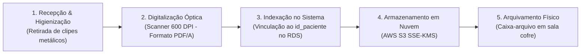

# Gestão de Prontuários Físicos e Documentos Legados

## 1. Escopo e Contexto Operacional

Embora a **Vitalis Saúde Digital** opere com foco primário em prontuários eletrônicos em nuvem (PEP), a plataforma mantém rotinas padronizadas para a custódia, digitalização e descarte seguro de documentos em suporte físico (papel) em dois cenários:

1. **Migração de Clínicas Credenciadas:** Recepção de acervos históricos em papel de consultórios e clínicas parceiras que aderem à plataforma.
2. **Termos Manuscritos e Laudos Externos:** Termos de consentimento livre e esclarecido (TCLE) assinados manualmente e exames diagnósticos externos apresentados fisicamente pelo paciente.

---

## 2. Estrutura e Identificação da Pasta Física

Cada prontuário físico é acondicionado em pasta suspensa individual plastificada, padronizada com as seguintes divisões internas:

| Seção da Pasta | Conteúdo Documental | Finalidade |
| :--- | :--- | :--- |
| **Capa Padrão** | Etiqueta com `id_paciente`, Nome Completo, CPF e Data de Nascimento | Identificação visual rápida e vinculação unívoca com o banco de dados. |
| **Identificação & Contatos** | Ficha cadastral física, telefones e contatos de emergência | Referência administrativa primária. |
| **Termo de Consentimento** | TCLE original assinado a punho pelo paciente ou responsável legal | Validade jurídica do consentimento de tratamento de dados (LGPD Art. 11). |
| **Anamnese e Evoluções** | Fichas clínicas pautadas com registros históricos, carimbo e assinatura do médico | Histórico pericial anterior à digitalização. |
| **Exames e Laudos Anexos** | Resultados laboratoriais e relatórios médicos impressos | Fixados com grampo plástico (prevenindo oxidação metálica). |

---

## 3. Fluxo de Digitalização e Integração com a Plataforma

Todo documento físico recebido é obrigatoriamente digitalizado e indexado à plataforma em até 48 horas úteis:

1. **Digitalização de Alta Resolução:** Digitalização em resolução mínima de 300 a 600 DPI, formato **PDF/A** (padrão arquivístico internacional de preservação de longo prazo).
2. **Indexação no Banco Operacional:** O arquivo digitalizado é vinculado ao `id_paciente` na tabela `PRONTUARIO` ou como anexo no **AWS RDS PostgreSQL**.
3. **Upload Seguro:** Envio direto para o bucket criptografado do **AWS S3** (`vitalis-prod-laudos`) com chave gerenciada no **AWS KMS**.
4. **Localização Topográfica:** O sistema registra a posição física do documento original em papel (Exemplo: *Arquivo Central, Corredor 1, Armário B, Caixa 12*).

---

## 4. Segurança Física, Custódia e Acesso

* **Ambiente de Guarda:** Sala de arquivo dedicada na sede administrativa da Vitalis, trancada, com climatização controlada (umidade entre 45% e 55%) e sistema anti-incêndio por gás inerte (sem água, para preservar o papel).
* **Controle de Acesso Físico:** Entrada permitida exclusivamente à equipe de arquivo documental autorizada.
* **Cadeia de Custódia (Livro de Cautela):** Qualquer retirada temporária de pasta física exige registro manual e digital (responsável, motivo clínico/jurídico, data de saída e devolução obrigatória em até 48 horas).
* **Tempo de Guarda Obrigatório:** O suporte físico é mantido pelo prazo mínimo de **20 (vinte) anos**, em estrita conformidade com o Art. 6º da Lei nº 13.787/2018 e resoluções do Conselho Federal de Medicina (CFM).

---

## 5. Matriz de Riscos Físicos e Mitigações

| Risco Físico | Impacto | Estratégia de Mitigação |
| :--- | :--- | :--- |
| **Incêndio ou Alagamento** | Perda irreversível de registros históricos | Sala elevada do solo, extintores à base de gás inerte (FM-200) e digitalização prévia no AWS S3. |
| **Degradação Natural do Papel** | Ilegibilidade de anotações médicas | Uso de grampos plásticos (sem oxidação), ambiente livre de incidência solar direta e cópias digitais em PDF/A. |
| **Extravio ou Acesso Não Autorizado** | Violação de sigilo médico e infração da LGPD | Sala com acesso biométrico restrito, etiquetagem por código e protocolo rígido de cautela com devolução controlada. |
